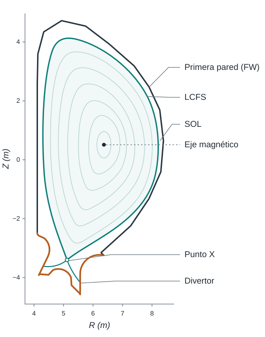
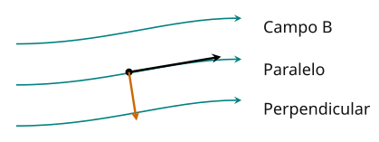
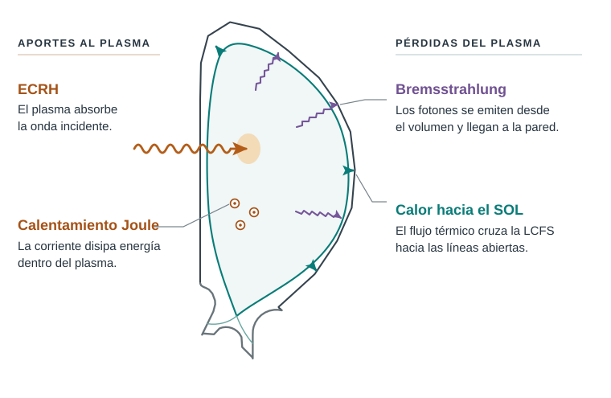
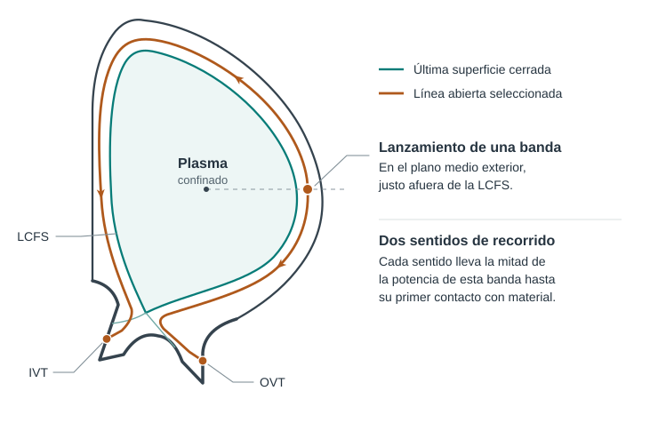
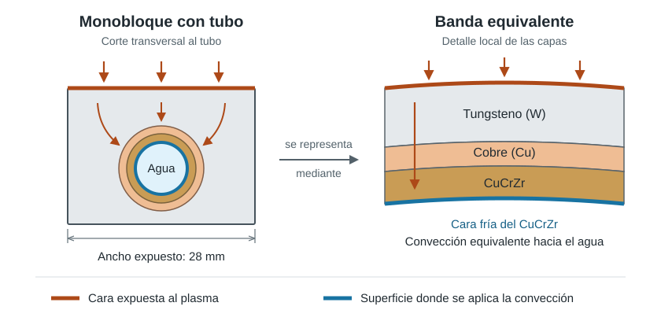
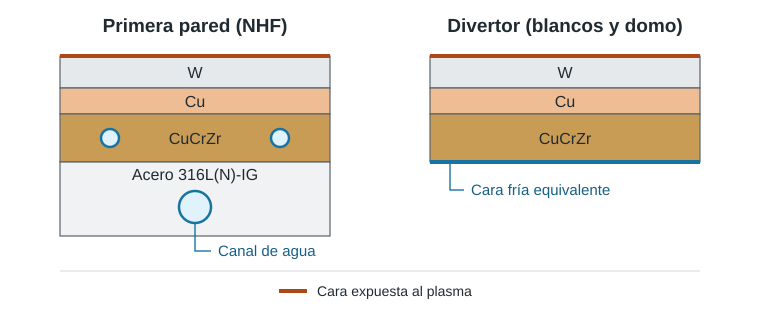

# Modelo térmico transitorio 2D axisimétrico de un tokamak tipo ITER

## 1. Objetivo y orden de cálculo

El objetivo es calcular cómo evoluciona la temperatura del plasma confinado y cómo se distribuye el calor que llega a la primera pared y al divertor. Se resuelve un equilibrio magnético estacionario y, sobre esa geometría, un problema térmico transitorio. Las incógnitas térmicas son la temperatura del plasma y las temperaturas de cuatro sólidos independientes: primera pared de flujo térmico normal (FW o NHF), blanco vertical interior (IVT), domo extendido y blanco vertical exterior (OVT).

El cálculo sigue este orden:

1. Resolver Grad–Shafranov con frontera libre. Obtener el flujo poloidal, el campo magnético dentro y fuera del plasma, el eje magnético, el punto X y la última superficie cerrada de flujo (LCFS).
2. Construir el dominio térmico del plasma. Asignar la densidad y la temperatura inicial a partir de los perfiles de entrada.
3. Con el equilibrio fijo, calcular los datos espaciales reutilizables: proyección de corriente para el calentamiento óhmico, perfil de depósito ECRH, peso de la Robin en la LCFS, trayectorias abiertas, primeros impactos y áreas receptoras.
4. Resolver la ecuación transitoria del plasma. En cada estado térmico se evalúan las conductividades, las fuentes y las dos potencias de salida: la que atraviesa la LCFS y la que se emite como radiación.
5. Distribuir ambas potencias sobre las superficies receptoras. Entregar a cada sólido la carga superficial que le corresponde.
6. Resolver la conducción transitoria multicapa con refrigeración por agua. Obtener los campos de temperatura, la energía almacenada, la potencia extraída por el agua y el balance global.

El acoplamiento térmico es unidireccional desde el plasma hacia los sólidos. La temperatura que alcanza el tungsteno depende de la carga recibida y de la respuesta de la pieza. La temperatura del plasma se calcula con su propia ecuación y condición de borde. El campo magnético permanece fijo durante todo el transitorio.

### 1.1. Suposiciones generales

- La geometría y los campos son axisimétricos. El equilibrio magnetohidrodinámico es estacionario y se mantiene fijo mientras evolucionan las temperaturas.
- El plasma es deuterio totalmente ionizado, con igual densidad de electrones e iones y una temperatura común. La densidad puede variar de un punto a otro, pero en cada punto permanece fija durante el transitorio.
- La ecuación de energía del plasma considera almacenamiento y conducción anisotrópica.
- El plasma recibe energía por calentamiento óhmico y ECRH. La pérdida radiativa volumétrica considerada es la radiación de frenado.
- Una condición Robin relaciona la temperatura en la LCFS con el flujo de calor que la atraviesa. En el SOL se reparte la potencia resultante siguiendo las líneas abiertas del campo, sin resolver otra temperatura ni almacenar energía. Cada banda entrega la mitad de su potencia en cada sentido del campo.
- La radiación que sale del plasma se reparte uniformemente por unidad de área expuesta, con absorción efectiva unitaria.
- La primera pared y las tres piezas del divertor se representan mediante sólidos equivalentes con contacto térmico perfecto entre sus capas. La refrigeración se calcula con agua monofásica a temperatura y presión prescritas.

Las condiciones iniciales fijan el estado en $t=0$. La temperatura inicial del plasma se obtiene de los perfiles de presión y densidad, y los cuatro sólidos comienzan a la temperatura del agua.

## 2. Coordenadas, dominios y unidades

Se usan coordenadas cilíndricas $(R,\phi,Z)$. El radio $R$ se mide desde el eje geométrico de la máquina, $Z$ es la altura y $\phi$ es el ángulo toroidal. La axisimetría implica $\partial_\phi=0$. La figura 1 ubica el dominio confinado, las líneas abiertas y las superficies materiales en un corte poloidal.



*Figura 1. Dominios en el plano $R,Z$. La curva cerrada que llega al punto X delimita el plasma. Las ramas que continúan desde X hacia el divertor quedan fuera de ese dominio.*

| Símbolo | Significado |
|---|---|
| $\Omega_m$ | Sección completa de la malla magnética, incluidas bobinas, vacío y regiones pasivas |
| $\Omega_p$ | Sección del plasma confinado calculada con Grad–Shafranov |
| $\Gamma_c$ | Lazo de la LCFS que encierra $\Omega_p$ |
| $\Omega_{c,i}$ | Sección poloidal de la bobina $i$ |
| $\Omega_{j,i}$ | Capa de material $i$ del sólido $j$, con $j\in\mathcal J=\{\mathrm{FW,IVT,domo,OVT}\}$ |
| $\Gamma_{\mathrm{exp},j}$ | Cara expuesta del sólido $j$ que recibe potencia del plasma |
| $\Gamma_{\mathrm{agua},j}$ | Contorno de canales NHF o cara fría equivalente del divertor |
| $\mathbf n_p,\mathbf n_j$ | Normales salientes del plasma y del sólido, respectivamente |

Se distingue el área del corte poloidal $dS_p=dR\,dZ$ del volumen y del área física que se generan al girar el corte:

```math
dV=2\pi R\,dR\,dZ,\qquad dA=2\pi R\,d\ell .
```

Aquí $d\ell$ es arco en el plano $R,Z$. $\int_{\Omega}(\cdot)\,dV$ y $\int_{\Gamma}(\cdot)\,dA$ representan el volumen y la superficie de revolución completos. La corriente toroidal que atraviesa una sección y el flujo magnético toroidal que atraviesa ese mismo corte se integran con $dS_p$.

| Magnitud | Símbolo | Unidad |
|---|---|---|
| Temperatura | $T$ | K |
| Energía térmica por partícula usada en las leyes de plasma | $\theta=k_BT$ | J |
| Densidad numérica de una especie | $n$ | $\mathrm{m^{-3}}$ |
| Campo magnético y densidad de corriente | $\mathbf B,\mathbf J$ | T, $\mathrm{A/m^2}$ |
| Conductividad térmica y capacidad calorífica específica | $k,c_p$ | $\mathrm{W/(m\,K)}$, $\mathrm{J/(kg\,K)}$ |
| Fuente o pérdida volumétrica | $S$ | $\mathrm{W/m^3}$ |
| Vector de flujo térmico y flujo normal por área | $\mathbf q,q''$ | $\mathrm{W/m^2}$ |
| Potencia y energía almacenada | $P,U$ | W, J |
| Coeficiente de intercambio por área | $h$ o $H$ | $\mathrm{W/(m^2\,K)}$ |

Por convención, $`q_{\mathrm{sep}}^{\prime\prime}>0`$ indica calor que sale del plasma y $`q_{\mathrm{in},j}^{\prime\prime}>0`$ indica calor que entra al sólido.

### 2.1. Constantes y parámetros de referencia

| Dato | Valor usado |
|---|---:|
| Constante de Boltzmann $k_B$ | $1.380649\times10^{-23}\ \mathrm{J/K}$ |
| Carga elemental $e$ | $1.602176634\times10^{-19}\ \mathrm C$ |
| Equivalencia del electrón-voltio | $1\ \mathrm{eV}=1.602176634\times10^{-19}\ \mathrm J$ |
| Masa electrónica $m_e$ | $9.1093837139\times10^{-31}\ \mathrm{kg}$ |
| Masa del deuterón $m_D$ | $3.3435837768\times10^{-27}\ \mathrm{kg}$ |
| Permitividad del vacío $\varepsilon_0$ | $8.8541878188\times10^{-12}\ \mathrm{F/m}$ |
| Permeabilidad del vacío $\mu_0$ | $1.25663706212\times10^{-6}\ \mathrm{H/m}$ |
| Radio mayor y campo toroidal nominales | $R_0=6.2\ \mathrm m$, $B_0=5.3\ \mathrm T$ |
| Corriente de plasma de referencia | $I_p=+15.6\ \mathrm{MA}$ |
| Agua de refrigeración | $T_f=343.15\ \mathrm K$, $p_f=4.0\ \mathrm{MPa}$ |

## 3. Archivos de entrada

| Archivo | Contenido | Uso |
|---|---|---|
| `perfiles_magneticos.csv` | 257 filas. Columnas `psi_Wb,psi_norm,p_Pa,F_Tm,pprima,FFprima` | Perfiles de equilibrio y presión inicial |
| `perfil_densidad.csv` | 257 filas. Columnas `psi_norm,n_m3` | Densidad fija de electrones y de iones |
| `ITER_mesh.h5` | 4757 nodos, 9400 triángulos, 20 regiones | Dominio magnético y secciones de bobinas |
| `geometria_pared.csv` | 39 vértices ordenados, `R_m,Z_m` | Cara expuesta de la primera pared |
| `geometria_divertor.csv` | 42 vértices ordenados, `R_m,Z_m` | Caras expuestas del divertor y conectores |

En el H5, `/mesh/r` contiene las coordenadas $(R,Z)$ en metros, `/mesh/lc` contiene los tres índices de nodo de cada triángulo desde cero, y `/mesh/reg` contiene su región. `/mesh/coil_dict` y `/mesh/cond_dict` identifican bobinas y regiones conductoras. Esta malla corresponde a la etapa magnética. Las capas, canales y caras frías de los sólidos forman parte de las mallas térmicas.

## 4. Equilibrio magnético de frontera libre

### 4.1. Flujo, campo y corriente

La incógnita del equilibrio es $\psi$, el flujo magnético poloidal por radián. El flujo poloidal total correspondiente es $2\pi\psi$. En una geometría axisimétrica, $\psi=R A_\phi$, donde $R$ es la distancia al eje de la máquina y $A_\phi$ es la componente toroidal del potencial vector magnético $\mathbf A$. Este potencial es un campo auxiliar relacionado con el campo magnético por $\mathbf B=\nabla\times\mathbf A$. Se usa la convención COCOS 7, con $\phi$ creciente en sentido antihorario visto desde arriba. En este caso $I_p>0$, $B_\phi>0$ y $\psi$ decrece del eje magnético a la separatriz [1], [2].

En el plasma se define $F(\psi)=RB_\phi$. Las componentes del campo son

```math
B_R=-\frac{1}{R}\partial_Z\psi,\qquad
B_Z=\frac{1}{R}\partial_R\psi,\qquad
B_\phi=\frac{F(\psi)}{R}.
```

Por construcción, $\mathbf B\cdot\nabla\psi=0$. Las curvas de $\psi$ constante describen las líneas de campo proyectadas en el plano poloidal. En la cámara exterior, con $R>0$, la ausencia de corriente poloidal y la continuidad del campo toroidal dan

```math
F_{\mathrm{vac}}=F(1)=32.8600006\ \mathrm{T\,m},\qquad
B_{\phi,\mathrm{ext}}=\frac{F_{\mathrm{vac}}}{R}.
```

Aquí y en los perfiles, $F(1)$ designa el valor en la coordenada normalizada $s=1$. El campo poloidal exterior sí varía con la solución de Grad–Shafranov.

### 4.2. Forma fuerte y perfiles dimensionales

En el equilibrio, la fuerza magnética por unidad de volumen compensa el gradiente de presión del plasma: $\mathbf J\times\mathbf B=\nabla p$. Aquí $\mathbf J$ es la densidad de corriente y $\mathbf B$ es el campo magnético. Ambas magnitudes están relacionadas por la ley de Ampère, $\mu_0\mathbf J=\nabla\times\mathbf B$.

Si en la figura 1 seguimos una curva cerrada de $\psi$ constante, la presión $p$ y la cantidad $F=RB_\phi$ mantienen su valor a lo largo de esa curva. Al pasar a otra curva, sus valores pueden cambiar. Por eso los perfiles de entrada especifican $p$ y $F$ en función de $\psi$. Al combinar el balance de fuerzas con la componente toroidal de la ley de Ampère se obtiene la ecuación de Grad–Shafranov [1], [2]:

```math
-\Delta^{*}\psi=\mu_0RJ_\phi,\qquad
\Delta^{*}\psi=\partial_{RR}\psi-\frac{1}{R}\partial_R\psi+\partial_{ZZ}\psi,
```

```math
J_\phi=
\left\{\begin{array}{ll}
Rp'(\psi)+\dfrac{FF'(\psi)}{\mu_0R}, & (R,Z)\in\Omega_p,\\
I_{\mathrm{eff},i}/A_{c,i}, & (R,Z)\in\Omega_{c,i},\\
0, & \text{vacío y regiones pasivas}.
\end{array}\right.
```

En particular, dentro del plasma el miembro derecho es $\mu_0R^2p'+FF'$. El área de bobina $A_{c,i}=\int_{\Omega_{c,i}}dS_p$ se obtiene de sus triángulos. La densidad de corriente es uniforme en cada sección de bobina.

| Columna | Interpretación |
|---|---|
| `psi_Wb` | $\psi$ dimensional tabulado, en $\mathrm{Wb/rad}$ |
| `psi_norm` | Coordenada de superficie $s=(\psi-\psi_a)/(\psi_{\mathrm{sep}}-\psi_a)$ |
| `p_Pa` | Presión total de electrones e iones, en Pa |
| `F_Tm` | $F=RB_\phi$, en $\mathrm{T\,m}$ |
| `pprima` | $p'=dp/d\psi$, en $\mathrm{Pa}/(\mathrm{Wb/rad})$ |
| `FFprima` | $FF'=\tfrac12d(F^2)/d\psi$, en T con radián adimensional |

Se interpolan las columnas usando $s$, que va de cero en el eje magnético a uno en la LCFS. Las primas tabuladas son derivadas respecto del flujo dimensional. Por ejemplo, $dp/ds=(\psi_{\mathrm{sep}}-\psi_a)p'$. Una vez calculado el equilibrio, se debe comprobar que $\psi_{\mathrm{sep}}-\psi_a$ sea compatible, dentro de la tolerancia numérica, con los $-14.986926409\ \mathrm{Wb/rad}$ de los perfiles.

### 4.3. Bobinas

Las corrientes de las bobinas se toman del caso de referencia de TokaMaker [3]. En la tabla, $I_{\mathrm{vuelta}}$ es la corriente que circula por cada vuelta y $N_{\mathrm{eff}}$ es el número efectivo de vueltas usado en ese caso. Para obtener la corriente equivalente de cada bobina se multiplican ambos datos: $I_{\mathrm{eff}}=N_{\mathrm{eff}}I_{\mathrm{vuelta}}$. Al dividir $I_{\mathrm{eff}}$ entre el área de la sección de la bobina se obtiene la densidad de corriente $J_\phi$ usada en Grad–Shafranov.

| Región en `ITER_mesh.h5` | Bobina | $I_{\mathrm{vuelta}}$ (A) | $N_{\mathrm{eff}}$ |
|---:|---|---:|---:|
| 7 | CS3U | +5180.432355 | 553.0 |
| 8 | CS2U | −16660.614010 | 553.0 |
| 9 | CS1U | −36367.324650 | 553.0 |
| 10 | CS1L | −36367.324650 | 553.0 |
| 11 | CS2L | −16472.058140 | 553.0 |
| 12 | CS3L | +8671.718870 | 553.0 |
| 13 | PF1 | +21725.942640 | 248.6 |
| 14 | PF2 | −22213.700010 | 115.2 |
| 15 | PF3 | −31877.987930 | 185.9 |
| 16 | PF4 | −26721.165200 | 169.9 |
| 17 | PF5 | −38450.075020 | 216.8 |
| 18 | PF6 | +39603.475950 | 459.4 |
| 19 y 20 | VSU y VSL, circuito VS | 0 | — |

Para calcular la corriente equivalente se usan los valores de $N_{\mathrm{eff}}$ de la tabla. El valor `nturns=1` que aparece en los metadatos de la malla corresponde a la representación de las bobinas en el archivo. Las bobinas VSU y VSL tienen corriente prescrita nula en este escenario, por lo que $I_{\mathrm{eff}}=0$ para ambas.

La región 1 de la malla delimita la zona donde se busca el plasma. Al resolver el equilibrio se obtiene la última superficie cerrada de flujo (LCFS). La parte de la región 1 encerrada por esa superficie forma el dominio confinado $\Omega_p$, donde se aplica la densidad de corriente del plasma. En el resto de la región 1 se usa $J_\phi=0$. Las regiones 2 a 6 corresponden a `AIR`, `VACUUM1`, `VACUUM2`, `VV1` y `VV2`, respectivamente. En este escenario también se usa $J_\phi=0$ en esas cinco regiones.

### 4.4. Fronteras y núcleo de Green

En el eje geométrico $R=0$ se usa la referencia $\psi=0$ y la regularidad $\psi=O(R^2)$. En la frontera exterior de la malla, $\Gamma_{\mathrm{ext}}$, se prescribe el flujo producido por todas las corrientes de plasma y bobinas en espacio libre [1], [3]. Para $x=(R,Z)$ y $x'=(R',Z')$,

```math
m=\frac{4RR'}{(R+R')^2+(Z-Z')^2},\qquad
G(x,x')=\frac{\mu_0\sqrt{RR'}}{2\pi\sqrt m}
\left[(2-m)K(m)-2E(m)\right],
```

donde $K$ y $E$ son las integrales elípticas completas de primera y segunda especie evaluadas con el parámetro $m$. Para $x\in\Gamma_{\mathrm{ext}}$,

```math
\psi(x)=
\int_{\Omega_p}G(x,x')J_{\phi,p}(x')\,dS'_p
+\sum_i\int_{\Omega_{c,i}}G(x,x')J_{\phi,c,i}(x')\,dS'_p .
```

En estas integrales, $x'$ indica dónde pasa la corriente y $x$ es el punto del borde de la malla donde queremos calcular $\psi$. Al girar el corte, un pequeño elemento situado en $x'$ forma un anillo que lleva una corriente $J_\phi(x')\,dR'\,dZ'$, en amperios. El núcleo de Green $G(x,x')$ indica cuánto flujo por radián produce ese anillo en $x$ por cada amperio de corriente. La integral suma los aportes de todos los anillos del plasma y de las bobinas. El efecto de la vuelta completa ya está incluido en $G$.

En el eje de la máquina se usa el valor límite de $G$ cuando $R$ tiende a cero. Si dos regiones comparten una frontera sin corriente superficial, $\psi$ y $R^{-1}\partial_n\psi$ tienen el mismo valor a ambos lados. Para comparar las derivadas se toma la misma dirección normal en los dos lados.

La frontera del plasma se obtiene al resolver el equilibrio magnético. En el corte de la figura 1, la separatriz forma un lazo que pasa por el punto X y rodea el eje magnético. El área encerrada por ese lazo es el dominio del plasma confinado $\Omega_p$. Las dos ramas que van desde el punto X hasta el divertor quedan fuera de ese dominio, al igual que la zona entre ellas, llamada región de flujo privado.

Una vez identificado $\Omega_p$, se calcula la corriente total del plasma integrando $J_{\phi,p}$ sobre su sección: $I_p=\int_{\Omega_p}J_{\phi,p}\,dR\,dZ$. El resultado se compara con los $+15.6\ \mathrm{MA}$ de referencia. Para calcular el flujo en el borde exterior de la malla con la fórmula de Green, se usa esa misma distribución de corriente del plasma junto con las corrientes de las bobinas.

### 4.5. Forma débil

Al dividir la ecuación de Grad–Shafranov por $R$, se obtiene $-\nabla_{RZ}\cdot(R^{-1}\nabla_{RZ}\psi)=\mu_0J_\phi$. Se multiplica por una función de prueba $v$ y se integra con $dS_p$. Al pasar una derivada a $v$ mediante integración por partes resulta

```math
\int_{\Omega_m}\frac{\nabla\psi\cdot\nabla v}{R}\,dS_p
-\int_{\partial\Omega_m}v\,\frac{\partial_n\psi}{R}\,d\ell
=\mu_0\int_{\Omega_m}J_\phi v\,dS_p .
```

En el borde exterior, el valor de $\psi$ viene dado por la fórmula de Green de la sección 4.4. Como ese valor está fijado para este paso del cálculo, se toman funciones de prueba que valen cero allí. En el eje también se respeta la condición $\psi=0$ y su comportamiento regular cuando $R$ tiende a cero. En las fronteras entre regiones, las contribuciones de los dos lados se cancelan. Así se obtiene la forma débil:

```math
\int_{\Omega_m}\frac{\nabla\psi\cdot\nabla v}{R}\,dS_p
=\mu_0\int_{\Omega_p}J_{\phi,p}v\,dS_p
+\mu_0\sum_i\int_{\Omega_{c,i}}J_{\phi,c,i}v\,dS_p .
```

Esta integral magnética usa $dR\,dZ$ y el peso $1/R$ que proviene del operador. Las ecuaciones de energía de las secciones siguientes usan el volumen físico $dV$.

## 5. Energía y transporte térmico del plasma

### 5.1. Estado inicial y conservación local

El plasma es deuterio completamente ionizado, con $Z_{\mathrm{eff}}=1$, $n_e=n_i=n$ y $T_e=T_i=T$. La densidad de cada especie se lee de `perfil_densidad.csv`. Su perfil es

```math
n(s)=\left[3.9+5.8(1-s^{9.15})\right]10^{19}\ \mathrm{m^{-3}},\qquad 0\le s\le1 .
```

Durante el transitorio, cada punto conserva su densidad inicial mientras su temperatura puede cambiar.

La presión inicial es $p=n_ek_BT_e+n_ik_BT_i$. La energía interna por volumen suma $\tfrac32nk_BT$ por especie. Así se obtienen

```math
T_0(s)=\frac{p(s)}{2n(s)k_B},\qquad
u_p=3nk_BT,\qquad C_V=3nk_B .
```

$C_V$ es la capacidad calorífica volumétrica, en $\mathrm{J/(m^3\,K)}$. Al inicio, $k_BT_0$ vale aproximadamente $15.959\ \mathrm{keV}$ en el eje y $200\ \mathrm{eV}$ en la LCFS. La temperatura de borde evoluciona a partir de ese valor.

Sin advección macroscópica ni trabajo de compresión, la forma fuerte es

```math
3nk_B\partial_tT+\frac{1}{R}\partial_R(Rq_R)+\partial_Zq_Z
=S_C,\qquad S_C=S_{\mathrm{ohm}}+S_{\mathrm{ECRH}}-S_{\mathrm{br}} .
```

La acumulación, la divergencia del flujo y la fuente neta están en $\mathrm{W/m^3}$. La sección 6 define los tres términos de $S_C$.

### 5.2. Tiempos de colisión y magnetización

Las leyes de Braginskii para carga iónica unitaria usan tiempos de colisión distintos para electrones e iones [4]. Para los logaritmos de Coulomb se usa la rama caliente del *NRL Plasma Formulary* [5]. Sea $\theta=k_BT$ en J, $t_{\mathrm{eV}}=\theta/(1.602176634\times10^{-19}\ \mathrm J)$ y $N=n/(10^6\ \mathrm{m^{-3}})$. Los dos últimos son valores numéricos de energía en eV y de densidad en $\mathrm{cm^{-3}}$, respectivamente. Con logaritmos naturales y $g=e^2/(4\pi\varepsilon_0)$,

```math
\begin{aligned}
\ell_{ei}&=24-\ln\left(\frac{\sqrt N}{t_{\mathrm{eV}}}\right),
&
\ell_{ii}&=23-\ln\left(\sqrt{2N}\,t_{\mathrm{eV}}^{-3/2}\right),\\
\tau_e&=\frac{3\sqrt{m_e}\,\theta^{3/2}}
{4\sqrt{2\pi}\,n g^2\ell_{ei}},
&
\tau_i&=\frac{3\sqrt{m_D}\,\theta^{3/2}}
{4\sqrt{\pi}\,n g^2\ell_{ii}} .
\end{aligned}
```

En las expresiones de $\tau_a$ se usa $n$ en $\mathrm{m^{-3}}$ y se obtienen segundos. Tanto el transporte como la resistividad usan esta misma evaluación. El intervalo adoptado es $10\le t_{\mathrm{eV}}<10m_D/m_e\simeq3.6705\times10^4$, con $n,T,B>0$, datos finitos y ambos logaritmos mayores que uno. Para $1<\ell<10$ se reduce la precisión del cierre. Un estado de prueba fuera del intervalo requiere una nueva evaluación admisible. Si el estado físico alcanzado queda fuera, se reporta el límite de la ley sin prolongarla con valores recortados.

Para $a=e,i$, con $m_i=m_D$ y $B=\sqrt{B_R^2+B_\phi^2+B_Z^2}$, se definen la frecuencia ciclotrónica en magnitud $\omega_{ca}$, el parámetro de magnetización $x_a$ y la escala de conductividad $A_a$:

```math
\omega_{ca}=\frac{eB}{m_a},\qquad x_a=\omega_{ca}\tau_a,\qquad
A_a=\frac{nk_B\theta\tau_a}{m_a}.
```

$x_a$ es adimensional. Cuando $x_a\gg 1$, el tiempo característico entre colisiones $\tau_a$ es largo comparado con $1/\omega_{ca}$. La escala de conductividad $A_a$ se expresa en $\mathrm{W/(m\,K)}$.

### 5.3. Conductividades y tensor

La figura 2 muestra las dos direcciones físicas de conducción. Las contribuciones clásicas por especie, en $\mathrm{W/(m\,K)}$, son [4, §4, tabla 2]

```math
\begin{aligned}
k_{\parallel,e}&=3.1616A_e,
& k_{\perp,e}&=A_e\frac{4.664x_e^2+11.92}{x_e^4+14.79x_e^2+3.7703},\\
k_{\parallel,i}&=3.906A_i,
& k_{\perp,i}&=A_i\frac{2x_i^2+2.645}{x_i^4+2.70x_i^2+0.677}.
\end{aligned}
```

Se adopta una difusividad perpendicular adicional $\chi_0=2/3\ \mathrm{m^2/s}$ para representar transporte anómalo. Garbet et al. dan el contexto de transporte efectivo por especie [6]. El valor constante de $\chi_0$ es una elección exploratoria del proyecto. Multiplicarla por $C_V$ convierte la difusividad en conductividad:

```math
k_\parallel=k_{\parallel,e}+k_{\parallel,i},\qquad
k_\perp=k_{\perp,e}+k_{\perp,i}+3nk_B\chi_0 .
```



*Figura 2. Orientación local del transporte. Las curvas verdes representan el campo, la flecha negra indica la dirección paralela y la naranja la perpendicular. La dirección y magnitud del flujo real dependen del gradiente de temperatura.*

Sea $\mathbf b=\mathbf B/B$ y $\Delta k=k_\parallel-k_\perp$. La ley tridimensional de Fourier es $\mathbf q=-\mathbf K\nabla T$, con $\mathbf K=k_\perp\mathbf I+\Delta k\,\mathbf b\mathbf b^{\mathsf T}$. Como $\partial_\phi T=0$, para la ecuación térmica se usan el bloque poloidal y las componentes $(q_R,q_Z)$:

```math
\mathbf K_{RZ}=
\begin{pmatrix}
k_\perp+\Delta k\,B_R^2/B^2 & \Delta k\,B_RB_Z/B^2\\
\Delta k\,B_RB_Z/B^2 & k_\perp+\Delta k\,B_Z^2/B^2
\end{pmatrix},\qquad
\mathbf q_p=-\mathbf K_{RZ}\nabla_{RZ}T .
```

Aunque la temperatura se calcula en el plano $R,Z$, las líneas de campo también recorren el tokamak en la dirección toroidal. Para saber qué parte del transporte paralelo ocurre dentro del corte, hay que conocer la inclinación de la línea completa. Por eso los cocientes de la matriz usan $B=\sqrt{B_R^2+B_Z^2+B_\phi^2}$. En la LCFS, lejos del punto X, el campo es tangente a la superficie. Allí el calor conducido en dirección paralela al campo circula a lo largo de la LCFS, y la componente normal del flujo depende de la conductividad perpendicular.

Las conductividades de Braginskii se calculan con la densidad, la temperatura y el campo magnético de cada punto. Para evaluar si esa descripción local es adecuada, se compara la distancia característica que recorre una partícula entre colisiones, $\lambda_a=v_{\mathrm{th},a}\tau_a$, con la distancia a lo largo del campo en la que cambia apreciablemente la temperatura. En la dirección perpendicular se compara el radio de giro de la partícula, $\rho_a=v_{\mathrm{th},a}/\omega_{ca}$, con la distancia en la que cambia la temperatura al atravesar las superficies magnéticas. Aquí $v_{\mathrm{th},a}=\sqrt{2k_BT/m_a}$ es la velocidad térmica de la especie $a$. La descripción local es más adecuada cuando el recorrido entre colisiones y el radio de giro son pequeños frente a sus respectivas distancias de comparación.

### 5.4. Forma débil del plasma

Se multiplica la ecuación fuerte por una prueba $v(R,Z)$ y se integra en el volumen confinado. Escribiendo $\nabla_{\mathrm{axi}}\cdot\mathbf q_p=R^{-1}\partial_R(Rq_R)+\partial_Zq_Z$, se obtiene

```math
\int_{\Omega_p} C_V\partial_tT\,v\,dV+
\int_{\Omega_p}v\,\nabla_{\mathrm{axi}}\cdot\mathbf q_p\,dV
=\int_{\Omega_p}S_Cv\,dV .
```

La integración por partes da

```math
\int_{\Omega_p}v\,\nabla_{\mathrm{axi}}\cdot\mathbf q_p\,dV
=\int_{\Gamma_c}v\,\mathbf q_p\cdot\mathbf n_p\,dA
-\int_{\Omega_p}\mathbf q_p\cdot\nabla v\,dV .
```

En el volumen se sustituye Fourier. En la frontera se usa la única condición térmica de la LCFS, $\mathbf q_p\cdot\mathbf n_p=H_{\mathrm{ref}}g_cT_c$, con $T_c$ la traza de $T$ y los parámetros definidos en la sección 7.1. La forma débil resultante es

```math
\begin{aligned}
\int_{\Omega_p}3nk_B\partial_tT\,v\,dV
&+\int_{\Omega_p}(\mathbf K_{RZ}\nabla T)\cdot\nabla v\,dV\\
&+\int_{\Gamma_c}H_{\mathrm{ref}}g_cT_c\,v\,dA
=\int_{\Omega_p}(S_{\mathrm{ohm}}+S_{\mathrm{ECRH}}-S_{\mathrm{br}})v\,dV .
\end{aligned}
```

La integral Robin es positiva a la izquierda para una prueba positiva y flujo saliente. Ella contabiliza toda la pérdida por cruce de la LCFS. El perfil $T_0$ fija el valor inicial, aunque su derivada normal inicial pueda diferir de la impuesta por la Robin. El flujo que se entrega al reparto del SOL es el de la condición de frontera ensamblada.

## 6. Fuentes y pérdidas del plasma

La figura 3 distingue las dos entradas de energía de las dos salidas. La emisión de fotones es una pérdida volumétrica. La salida hacia el SOL es una pérdida superficial calculada con la temperatura de borde.



*Figura 3. Entradas y salidas de energía del plasma.*

### 6.1. Calentamiento óhmico

Se usa la disipación de Joule de una corriente inductiva equivalente paralela a $\mathbf B$. En el plasma, Grad–Shafranov aporta $J_\phi$ y las componentes poloidales se calculan como $(J_R,J_Z)=(F'/\mu_0)(B_R,B_Z)$, con $F'=(FF')/F$. Sobre cada contorno cerrado regular $\mathcal C_s$ se define el promedio de una magnitud $X$ por volumen de una capa delgada entre superficies:

```math
\langle X\rangle_s=
\frac{\displaystyle\oint_{\mathcal C_s}X\,R\,d\ell/\lvert\nabla s\rvert}
{\displaystyle\oint_{\mathcal C_s}R\,d\ell/\lvert\nabla s\rvert}.
```

Para calcular el calentamiento óhmico, el proyecto aproxima la corriente inducida sobre cada superficie mediante un campo de la forma $\mathbf J_{\mathrm{ohm}}=C(s)\mathbf B$. Así, la corriente equivalente sigue la dirección del campo magnético. Se elige el factor $C(s)$ de modo que el promedio de $\mathbf J_{\mathrm{ohm}}\cdot\mathbf B$ coincida con el que se obtiene de la corriente del equilibrio, $\langle\mathbf J\cdot\mathbf B\rangle_s$:

```math
C(s)=\frac{\langle\mathbf J\cdot\mathbf B\rangle_s}{\langle B^2\rangle_s}
=\frac{F'}{\mu_0}+\frac{Fp'}{\langle B^2\rangle_s},\qquad
\mathbf J_{\mathrm{ohm}}=C(s)\mathbf B .
```

Se obtiene $C(s)$ una vez del equilibrio, tomando los límites de eje y separatriz desde contornos interiores regulares. La resistividad paralela usa el mismo $\tau_e$ de la sección 5.2 [4, §2]:

```math
\eta_\parallel=\frac{0.51m_e}{ne^2\tau_e},\qquad
S_{\mathrm{ohm}}(R,Z,t)=\eta_\parallel(n,T)\,C(s)^2B^2,\qquad
P_{\mathrm{ohm}}(t)=\int_{\Omega_p}S_{\mathrm{ohm}}\,dV .
```

$\eta_\parallel$ está en $\Omega\,\mathrm m$. La corriente proyectada permanece fija y la resistividad cambia con $T$. La proyección aproxima la corriente inductiva bajo la hipótesis de contribución paralela no inductiva pequeña. La potencia resultante cuenta como trabajo eléctrico externo implícito en el balance.

### 6.2. Calentamiento por resonancia ciclotrónica electrónica

El ECRH entrega $P_{\mathrm{ECRH}}=20\times10^6\ \mathrm W$ absorbidos durante la fase activa. El escenario de Di Siena et al. respalda la potencia y el depósito centrado en $\rho_{\mathrm{tor}}=0.4$ [7, §II]. La desviación estándar adimensional $\sigma=0.1$ es un parámetro adoptado por el proyecto.

Sea $\Omega(s)$ el corte encerrado por la superficie magnética $s$. El flujo toroidal atraviesa ese corte en dirección $\phi$, de modo que

```math
\Phi_{\mathrm{tor}}(s)=\int_{\Omega(s)}B_\phi\,dR\,dZ,\qquad
\rho_{\mathrm{tor}}(s)=\sqrt{\frac{\Phi_{\mathrm{tor}}(s)}{\Phi_{\mathrm{tor}}(1)}} .
```

$\Phi_{\mathrm{tor}}$ se mide en Wb. A partir de ese flujo se obtiene la coordenada $\rho_{\mathrm{tor}}$, que vale cero en el eje magnético y uno en la LCFS. El máximo del calentamiento se ubica en la superficie con $\rho_{\mathrm{tor}}=0.4$. Para repartir los 20 MW alrededor de esa superficie se usa el perfil $g(s)$. Este perfil indica qué zonas reciben más calentamiento. Su integral sobre el volumen del plasma, $I_g$, permite convertir ese reparto en una potencia por unidad de volumen cuya integral sea exactamente 20 MW:

```math
g(s)=\exp\left[-\frac{(\rho_{\mathrm{tor}}(s)-0.4)^2}{2(0.1)^2}\right],
\qquad I_g=\int_{\Omega_p}g(s)\,dV,\qquad
S_{\mathrm{ECRH}}=\frac{P_{\mathrm{ECRH}}}{I_g}g(s).
```

La integral de $S_{\mathrm{ECRH}}$ vale $20\ \mathrm{MW}$ durante el calentamiento. Se usa la cuadratura volumétrica del ensamblaje para calcular $I_g$. La potencia absorbida por los electrones entra una sola vez en la ecuación de temperatura común.

### 6.3. Bremsstrahlung

Los electrones cambian de dirección al pasar cerca de los iones de deuterio y emiten parte de su energía en forma de fotones. Esta pérdida se llama radiación de frenado o *bremsstrahlung*. Se supone que los fotones atraviesan el plasma con una reabsorción despreciable. Con $n$ en $\mathrm{m^{-3}}$ y $t_{\mathrm{eV}}$ definido en la sección 5.2, la potencia emitida por unidad de volumen se calcula como [5, p. 58, ec. 30]

```math
S_{\mathrm{br}}=1.69\times10^{-38}n^2\sqrt{t_{\mathrm{eV}}}
\quad[\mathrm{W/m^3}],\qquad
P_{\mathrm{br}}(t)=\int_{\Omega_p}S_{\mathrm{br}}\,dV .
```

$S_{\mathrm{br}}$ es emisión positiva y por ello se resta del plasma. El reparto radiativo usa exactamente esa potencia integrada. La composición y las fuentes del caso base excluyen potencia alfa, calentamiento por fusión y radiación de impurezas.

## 7. Acoplamiento entre la LCFS, el SOL y los receptores

### 7.1. Condición Robin y potencia que cruza la LCFS

Horáček et al. reportan $P_{\mathrm{SOL,ref}}=18\ \mathrm{MW}$ y $A_{\mathrm{LCFS,ref}}=557\ \mathrm{m^2}$ para el mismo escenario ITER L-mode de 12 MA [8, tabla 1]. Del estudio se toma la densidad media de potencia. Del proyecto se toma una temperatura de referencia de borde equivalente a $200\ \mathrm{eV}$. Así se define la conductancia efectiva

```math
\begin{aligned}
q''_{\mathrm{ref}}&=\frac{18\times10^6}{557}
=32315.98\ \mathrm{W/m^2},\\
T_{\mathrm{ref}}&=\frac{200(1.602176634\times10^{-19}\ \mathrm J)}{k_B}
\simeq2.32090\times10^6\ \mathrm K,\\
H_{\mathrm{ref}}&=\frac{q''_{\mathrm{ref}}}{T_{\mathrm{ref}}}
\simeq0.01392388\ \mathrm{W/(m^2\,K)} .
\end{aligned}
```

El proyecto supone que el flujo de calor que sale por cada punto de la LCFS es proporcional a la temperatura del plasma en ese punto. También permite que dos puntos a la misma temperatura pierdan distintas cantidades de calor por unidad de área. Esa variación a lo largo del borde se representa con el factor $g_c$.

Para calcularlo, se traza en el corte $R,Z$ una horizontal a la altura $Z_a$ del eje magnético. Se toma el punto donde esa horizontal corta la LCFS por el lado de mayor radio. Ese punto es $u_0=(R_u^0,Z_a)$, con $R_u^0>R_a$. Allí se calcula $D_u=\lvert\partial_R\psi(u_0)\rvert>0$, que sirve de referencia para comparar cuánto varía $\psi$ en los demás puntos del borde. El área $A_c$ se obtiene al girar la LCFS del equilibrio calculado:

```math
A_c=\int_{\Gamma_c}dA,\qquad
\mu_\psi=\frac{\lvert\nabla\psi\rvert}{D_u},\qquad
\bar\mu=\frac{1}{A_c}\int_{\Gamma_c}\mu_\psi\,dA,\qquad
g_c=\frac{\mu_\psi}{\bar\mu}.
```

$g_c$ es adimensional, tiene promedio superficial uno y permanece fijo. En cada instante se usa la temperatura absoluta calculada en el borde, $T_c=T|_{\Gamma_c}$:

```math
q''_{\mathrm{sep}}=\mathbf q_p\cdot\mathbf n_p
=H_{\mathrm{ref}}g_cT_c,\qquad
P_{\mathrm{SOL}}(t)=H_{\mathrm{ref}}\int_{\Gamma_c}g_c T_c\,dA .
```

Al inicio, todo el borde tiene la temperatura de referencia. Como el promedio de $g_c$ sobre la LCFS vale uno, la potencia inicial es $P_{\mathrm{SOL}}(0^+)=q''_{\mathrm{ref}}A_c$. Aquí hay dos áreas con funciones distintas. Los $557\ \mathrm{m^2}$ del estudio de Horáček se usaron para obtener $q''_{\mathrm{ref}}$ [8, tabla 1]. Para calcular cuántos Watts salen de nuestro plasma se usa el área $A_c$ de nuestro equilibrio. Durante el transitorio se integra el flujo usando la temperatura que alcanza cada punto del borde en ese instante.

La integral se evalúa a lo largo de la LCFS hasta llegar al punto X por cada lado. Basta con tomar el límite a lo largo de la curva, porque un punto aislado no aporta área a la integral. Una vez obtenida $P_{\mathrm{SOL}}$, la sección 7.2 explica cómo se reparte entre las superficies receptoras.

### 7.2. Primer impacto y reparto por banda

En el SOL (*scrape-off layer*) se sigue el recorrido de la potencia hasta las superficies sólidas. El modelo supone que esta región no almacena energía, por lo que el reparto se calcula sin resolver una temperatura propia del SOL. Primero se integra el flujo saliente sobre toda la LCFS. Después se distribuye la potencia obtenida entre bandas de lanzamiento en el plano medio exterior y se sigue cada banda hasta su primer impacto en ambos sentidos del campo, como muestra la figura 4.



*Figura 4. Desde el punto naranja del plano medio exterior se sigue una línea abierta en ambos sentidos. En este ejemplo, una rama llega al IVT y la otra al OVT. Cada impacto recibe la mitad de la potencia de la banda seleccionada. Los destinos y las posiciones de impacto se obtienen del campo magnético calculado.*

Para seguir una línea abierta, se parte del cruce exterior $u_0$ definido en la sección 7.1 y se avanza una distancia horizontal $r$ hacia radios mayores. El punto de partida queda en $(R_u^0+r,Z_a)$. Se consideran las distancias $r>0$ del intervalo $\mathcal I$ que comienza junto a la separatriz y pertenece al SOL común. En ese intervalo, el flujo de lanzamiento $\psi_u(r)=\psi(R_u^0+r,Z_a)$ varía de forma monótona, de modo que cada valor de $r$ identifica una línea. Desde el mismo punto se sigue la línea primero en un sentido del campo y luego en el contrario. El signo $\epsilon=\pm1$ distingue los dos recorridos:

```math
\frac{d(R,Z)}{d\ell_p}
=\epsilon\frac{(B_R,B_Z)}{B_p},\qquad B_p=\sqrt{B_R^2+B_Z^2}.
```

$\ell_p$ mide la distancia recorrida sobre la línea dibujada en el corte $R,Z$. En cada sentido se sigue la línea hasta que toca por primera vez una superficie material o atraviesa una abertura física de la cámara. La posición de llegada se guarda como $\mathbf y_\epsilon(r)$. Para localizar dónde llega la separatriz al material, se repite el trazado desde puntos cada vez más cercanos a ella. La posición a la que se acercan los impactos cuando $r\to0^+$ se llama *strike point*.

En la geometría del proyecto, el contorno material no tiene aberturas. Si una trayectoria llega al borde de los datos de campo antes de tocar una superficie, todavía falta determinar su destino físico.

Las bandas más próximas a la separatriz reciben mayor flujo de calor paralelo. En el plano de lanzamiento, el modelo hace disminuir ese flujo como $e^{-r/\lambda_q}$ hacia radios mayores. La distancia $\lambda_q=0.003\ \mathrm m$ se toma de la estimación de Horáček et al. para el régimen L-mode [8]. Al avanzar esos 3 mm, el flujo paralelo cae a $1/e$ de su valor de referencia. El proyecto usa este perfil de un solo lado y toma $S=0$, de modo que no añade un ensanchamiento hacia la región de flujo privado. El área perpendicular al campo de una banda radial es $J_u(r)\,dr$. Con $R_u=R_u^0+r$ y $B_u$ la magnitud del campo total en el lanzamiento,

```math
J_u(r)=2\pi R_u\frac{\lvert B_{Z,u}\rvert}{B_u},\qquad
\mathcal N=\int_{\mathcal I}J_u(r)e^{-r/\lambda_q}\,dr,\qquad
\rho_q(r)=\frac{J_u(r)e^{-r/\lambda_q}}{\mathcal N}.
```

$J_u$ está en m, $\mathcal N$ en $\mathrm{m^2}$ y $\rho_q$ en $\mathrm{m^{-1}}$. La integral de $\rho_q$ vale uno. El reparto 50/50 se aplica a cada banda radial:

```math
dP_\epsilon(r,t)=\frac{P_{\mathrm{SOL}}(t)}{2}\rho_q(r)\,dr,\qquad
f_j=\frac12\sum_{\epsilon=\pm1}\int_{\mathcal I}\rho_q(r)H_{\epsilon,j}(r)\,dr,\qquad
P_{\mathrm b,j}=f_jP_{\mathrm{SOL}} .
```

$H_{\epsilon,j}$ vale uno si el primer destino pertenece a $j$ y cero en otro caso. La suma sobre todos los destinos da $\sum_j f_j=1$. Las fracciones se obtienen del campo y la geometría del caso. Se garantiza igualdad entre las potencias de los dos blancos si cada banda llega una vez a cada blanco. Otras conexiones pueden depositar energía en la pared, el domo o los conectores.

### 7.3. Huella térmica y carga de elementos finitos

Para una cara o subcara $E$ de un receptor, la definición conservativa de la huella es

```math
P_{\mathrm b,E}=\int_E q''_{\mathrm b,j}\,dA
=\frac{P_{\mathrm{SOL}}(t)}{2}
\sum_{\epsilon=\pm1}
\int_{\{r\in\mathcal I:\,\mathbf y_\epsilon(r)\in E\}}\rho_q(r)\,dr .
```

El flujo medio en esa cara es $P_{\mathrm b,E}/A_E$, con $A_E=\int_E2\pi R\,d\ell$. La expresión integral admite varios intervalos de lanzamiento que impacten la misma cara. Una banda deposita su potencia una vez en cada dirección.

Donde el mapeo es regular, sea $\ell$ la coordenada de arco sobre el receptor. Conservar el flujo magnético elemental permite calcular la expansión y la densidad puntual:

```math
\begin{aligned}
f_x&=\left|\frac{d\ell}{dr}\right|
=\frac{\lvert d\psi_u/dr\rvert}{\lvert\partial_\ell\psi\rvert}
=\frac{R_u\lvert B_{Z,u}\rvert}
{R_j\lvert\mathbf B_j\cdot\mathbf n_j\rvert},\\
q''_{\mathrm b,j}(\ell,t)
&=\frac{P_{\mathrm{SOL}}(t)}{2}
\sum_{\epsilon,r:\,\mathbf y_\epsilon(r)=\mathbf y(\ell)}
\frac{\rho_q(r)}{2\pi R_j}\left|\frac{dr}{d\ell}\right| .
\end{aligned}
```

Tomemos dos líneas que salen de los bordes de una misma banda de lanzamiento. Si llegan al divertor muy separadas, la potencia de esa banda se reparte sobre una superficie mayor. Si llegan muy juntas, la misma potencia se concentra en una superficie menor y aumenta el flujo en $\mathrm{W/m^2}$. Por eso los 3 mm de $\lambda_q$ en el lanzamiento no fijan directamente la anchura de la huella sobre el blanco. La ecuación anterior ya tiene en cuenta la separación de los impactos y la inclinación con que llega el campo al material.

Cuando una línea roza la superficie, llega a un vértice o cambia de receptor al variar ligeramente el punto de partida, conviene usar la expresión integral de $P_{\mathrm b,E}$. Se suman los Watts que llegan a la cara $E$ y se divide por su área para obtener el flujo medio.

**Carga ponderada.** Para una función de prueba $v_j$ del sólido, la expresión anterior se generaliza ponderando cada impacto por el valor de la prueba en el punto de llegada:

```math
L_{\mathrm b,j}(v_j)=
\frac{P_{\mathrm{SOL}}(t)}{2}
\sum_{\epsilon=\pm1}
\int_{\{r:\,\mathbf y_\epsilon(r)\in\Gamma_{\mathrm{exp},j}\}}
\rho_q(r)\,v_j(\mathbf y_\epsilon(r))\,dr .
```

Si la superficie geométrica y la malla térmica son distintas, se evalúa $v_j$ en el punto correspondiente de la cara térmica. Si se transfieren Watts por faceta y se aproxima el flujo como constante en cada faceta receptora $E$, la carga discreta correspondiente es

```math
L_{\mathrm b,j}^{\mathrm{fac}}(v_j)=
\sum_{E\subset\Gamma_{\mathrm{exp},j}}
\frac{P_{\mathrm b,E}}{A_E^{\mathrm{malla}}}\int_E v_j\,dA .
```

La primera expresión conserva la distribución de impactos al ponderarla. La segunda conserva los Watts por faceta con la resolución espacial elegida. Para $v_j=1$ ambas recuperan la potencia entregada al receptor.

### 7.4. Receptores y radiación

Para dos vértices consecutivos del CSV con coordenadas $(R_i,Z_i)$ y $(R_{i+1},Z_{i+1})$, la arista recta tiene longitud $\ell_i=\sqrt{(R_{i+1}-R_i)^2+(Z_{i+1}-Z_i)^2}$ y área de revolución $A_i=\pi(R_i+R_{i+1})\ell_i$. En el divertor se usa la clasificación D mixta. La numeración empieza en el primer vértice de datos, con índice uno. El tramo $a$–$b$ contiene las aristas desde $a\to a+1$ hasta $b-1\to b$.

| Receptor | Tramo | Área expuesta nominal ($\mathrm{m^2}$) | Tratamiento |
|---|---|---:|---|
| Primera pared | Línea de pared | 677.803998 | Sólido NHF |
| IVT | 1–17 | 46.348216 | Sólido |
| Conector interior | 17–18 | 1.138593 | Receptor externo |
| Domo extendido | 18–30 | 60.234567 | Sólido, incluidas las aristas 18–19 y 29–30 |
| Conector exterior | 30–31 | 1.057520 | Receptor externo |
| OVT | 31–42 | 67.520430 | Sólido |

La radiación emitida por el plasma se distribuye uniformemente por área expuesta, con absorción efectiva unitaria. Esta hipótesis geométrica del proyecto prescinde de factores de vista, reflexiones y transporte espectral. Para áreas materiales $A_j$ y área de bocas físicas $A_{\mathrm{bocas}}$,

```math
A_{\mathrm{rad}}=\sum_{\mathrm{materiales}}A_j+A_{\mathrm{bocas}},\qquad
q''_{\mathrm{rad},j}=\frac{P_{\mathrm{br}}}{A_{\mathrm{rad}}},\qquad
P_{\mathrm{rad},j}=\frac{A_j}{A_{\mathrm{rad}}}P_{\mathrm{br}},\qquad
P_{\mathrm{rad,esc}}=\frac{A_{\mathrm{bocas}}}{A_{\mathrm{rad}}}P_{\mathrm{br}} .
```

Con todas las aristas originales expuestas y $A_{\mathrm{bocas}}=0$, el área receptora es $854.103324\ \mathrm{m^2}$. Los conectores absorben y contabilizan por separado sus Watts magnéticos y radiativos. Sus temperaturas quedan fuera del cálculo. El área receptora material y el área $A_c$ de la LCFS tienen funciones distintas.

La carga superficial total sobre un sólido es $q''_{\mathrm{in},j}=q''_{\mathrm b,j}+q''_{\mathrm{rad},j}$. Para una función de forma nodal $N_a$, la componente del vector de cargas es

```math
F_{a,j}=L_{\mathrm b,j}(N_a)
+\int_{\Gamma_{\mathrm{exp},j}}q''_{\mathrm{rad},j}N_a\,dA .
```

Si se remalla la cara, también se transfieren los Watts radiativos de cada parche a su correspondiente área de malla. La suma de las componentes nodales recupera la potencia incidente cuando las funciones de forma satisfacen $\sum_aN_a=1$.

## 8. Geometría térmica de la primera pared y el divertor

En los blancos interior y exterior del divertor, el calor atraviesa el tungsteno y llega al agua que circula por un tubo de CuCrZr rodeado por una capa de cobre. En el modelo axisimétrico, los tres materiales se representan mediante capas continuas. La cara expuesta sigue recibiendo la carga del plasma, mientras que la refrigeración del tubo se representa mediante una convección en la cara fría de la última capa.



*Figura 5a. Del monobloque a la banda equivalente en los blancos IVT y OVT. El coeficiente se ajusta al área de esa cara para conservar la conductancia térmica del tramo representado.*

La figura 5b muestra el orden de las capas y la ubicación de las superficies refrigeradas. Los espesores de cada componente se indican en la tabla siguiente.



*Figura 5b. Primera pared y divertor en corte. Los blancos y el domo se muestran juntos porque comparten la misma secuencia de materiales. Esquema sin escala.*

| Sólido | W (mm) | Cu (mm) | CuCrZr (mm) | 316L(N)-IG (mm) | Total (mm) |
|---|---:|---:|---:|---:|---:|
| Primera pared NHF | 12.0 | 2.0 | 20.8 | 36.9 | 71.7 |
| IVT | 8.8600 | 1.7952 | 2.2720 | — | 12.9272 |
| Domo extendido | 8.0000 | 2.0000 | 7.0000 | — | 17.0000 |
| OVT | 8.8600 | 1.7952 | 2.2720 | — | 12.9272 |

**Primera pared.** La sección combina la arquitectura NHF [9], la propuesta de 12 mm de W y 2 mm de cobre [10] y una sección representativa de CuCrZr y acero [11]. Las interfaces nominales están a 12.0, 14.0 y 34.8 mm de la cara expuesta. La celda transversal de referencia mide 41 mm. Los centros de canal se describen con una coordenada transversal respecto del centro de la celda y una profundidad medida desde la cara expuesta.

| Canal por celda | Material en contacto con agua | Diámetro interior | Profundidad del centro | Posición transversal |
|---|---|---:|---:|---:|
| Dos delanteros | CuCrZr | 10 mm | 23.0 mm | $-8$ y $+8$ mm |
| Uno posterior | 316L(N)-IG | 22 mm | 54.8 mm | 0 mm |

Los canales equivalentes forman anillos al girar el corte. En los dos delanteros se omite la camisa metálica y se aplica la convección directamente al CuCrZr [12]. En las primeras pruebas de mallado se pueden omitir temporalmente las perforaciones para comprobar las capas. Para la simulación refrigerada se necesitan los canales dentro de sus materiales, con sus superficies mojadas y condiciones convectivas.

**Blancos.** Los blancos IVT y OVT se construyen con monobloques de W/Cu/CuCrZr refrigerados por un tubo con cinta helicoidal [13]–[15]. En el modelo se usa la banda de tres capas de la figura 5a. El espesor de tungsteno de 8.86 mm se eligió para que la banda reproduzca aproximadamente la resistencia que encuentra el calor al atravesar el tungsteno del monobloque.

Esa simplificación también afecta el almacenamiento de energía. Para una misma área expuesta, la banda contiene aproximadamente el 44.5 % de la masa de tungsteno que correspondería al monobloque. Por eso puede representar la resistencia al paso del calor y, al mismo tiempo, responder de manera distinta ante un pulso corto. Esta diferencia debe tenerse en cuenta al interpretar las temperaturas máximas locales.

**Domo.** La totalidad del tramo 18–30 lleva las tres capas de la tabla y su cara fría. El domo se representa como baldosa W/Cu sobre un disipador de CuCrZr con refrigeración tipo *hypervapotron* [16]. Los 7 mm de CuCrZr son un espesor medio representativo. La sección reducida termina en esa capa. Los dos conectores cortos se contabilizan según la sección 7.4 y no unen térmicamente las tres piezas del divertor.

## 9. Propiedades de los sólidos

Las temperaturas que reciben las funciones están en K, $k$ en $\mathrm{W/(m\,K)}$, $c_p$ en $\mathrm{J/(kg\,K)}$ y $\rho$ en $\mathrm{kg/m^3}$. Las leyes de W, Cu y CuCrZr proceden de las entradas de materiales del ejemplo SALAMANDER/TMAP8 [15]. Para el acero se usa la tabla de Rego [17, apéndice A.3, tabla 26].

| Material | $\rho$ constante ($\mathrm{kg/m^3}$) | Intervalo de las propiedades |
|---|---:|---|
| W | 19300 | $293<T<2500\ \mathrm K$ |
| Cu puro equivalente al OFCu | 8960 | $293<T<873\ \mathrm K$ |
| CuCrZr | 8900 | $293<T<927\ \mathrm K$ |
| 316L(N)-IG | 7942.2 | $293.15\le T\le1073.15\ \mathrm K$ |

**Tungsteno.**

```math
\begin{aligned}
k_{\mathrm W}(T)&=241-0.290T+2.54\times10^{-4}T^2
-1.03\times10^{-7}T^3+1.52\times10^{-11}T^4,\\
c_{p,\mathrm W}(T)&=116+0.0711T-6.58\times10^{-5}T^2
+3.24\times10^{-8}T^3-5.45\times10^{-12}T^4 .
\end{aligned}
```

**Cobre.** En las entradas activas de [15] el ajuste lineal corresponde a conductividad y el cúbico a capacidad calorífica:

```math
k_{\mathrm{Cu}}(T)=421-0.0685T,\qquad
c_{p,\mathrm{Cu}}(T)=316+0.318T-3.49\times10^{-4}T^2+1.66\times10^{-7}T^3 .
```

**CuCrZr.** Se usa $k_{\mathrm{CuCrZr}}(T)=387-0.128T$ y $c_{p,\mathrm{CuCrZr}}(T)=390$.

**Acero 316L(N)-IG.** La tabla da la conductividad $k$ y la capacidad calorífica $c_p$ para 16 temperaturas. Si la temperatura calculada queda entre dos filas, se interpolan linealmente ambas propiedades entre los valores de esas filas. La primera columna está en grados Celsius, como en la fuente original. Para compararla con la temperatura de la simulación se convierte cada valor a kelvin. La densidad se mantiene constante en $7942.2\ \mathrm{kg/m^3}$, valor obtenido por interpolación a $70\ ^\circ\mathrm C$ [17].

| Temperatura (°C) | $k$ ($\mathrm{W/(m\,K)}$) | $c_p$ ($\mathrm{J/(kg\,K)}$) |
|---:|---:|---:|
| 20 | 13.94 | 470 |
| 50 | 14.37 | 476 |
| 100 | 15.08 | 486 |
| 150 | 15.80 | 497 |
| 200 | 16.52 | 508 |
| 250 | 17.24 | 518 |
| 300 | 17.95 | 529 |
| 350 | 18.67 | 539 |
| 400 | 19.39 | 550 |
| 450 | 20.10 | 560 |
| 500 | 20.82 | 571 |
| 550 | 21.54 | 582 |
| 600 | 22.25 | 592 |
| 650 | 22.97 | 603 |
| 700 | 23.69 | 613 |
| 800 | 25.12 | 634 |

El modelo excluye fusión, cambio de fase del sólido y degradación de materiales.

## 10. Refrigeración

### 10.1. Estado del agua y canales NHF

El agua se mantiene a $343.15\ \mathrm K$ y $4\ \mathrm{MPa}$ en todos los componentes. Se usan IAPWS-IF97 para $\rho_f$, $c_{p,f}$ y saturación, IAPWS R12-08 para viscosidad dinámica $\mu_f$ e IAPWS R15-11 para conductividad $k_f$ [18]. En el estado nominal se obtiene $\rho_f\simeq979.488\ \mathrm{kg/m^3}$, $c_{p,f}\simeq4179.64\ \mathrm{J/(kg\,K)}$, $\mu_f\simeq4.04568\times10^{-4}\ \mathrm{Pa\,s}$ y $k_f\simeq0.661824\ \mathrm{W/(m\,K)}$. La temperatura de saturación a esa presión es aproximadamente $523.508\ \mathrm K$.

Para los canales NHF se usa Dittus–Boelter con agua calentándose, bajo la aproximación de flujo turbulento desarrollado [19, §8–6]. Las velocidades representativas son 1.4 m/s delante y 0.7 m/s detrás [11]. Con velocidad $v_f$ y diámetro hidráulico $D_h$,

```math
\mathrm{Re}=\frac{\rho_f v_fD_h}{\mu_f},\qquad
\mathrm{Pr}=\frac{\mu_fc_{p,f}}{k_f},\qquad
\mathrm{Nu}_{\mathrm{base}}=0.023\,\mathrm{Re}^{0.8}\mathrm{Pr}^{0.4},\qquad
h_{\mathrm{BC}}=\frac{k_f\mathrm{Nu}_{\mathrm{base}}}{D_h}.
```

Se usa $D_h=0.010\ \mathrm m$ delante y $0.022\ \mathrm m$ detrás. Resultan aproximadamente $9323$ y $4573\ \mathrm{W/(m^2\,K)}$, respectivamente. El coeficiente se integra directamente sobre la superficie mojada generada por el contorno del orificio. La longitud de desarrollo hidráulico se entiende a lo largo de la dirección real del flujo.

### 10.2. Tubo con cinta en IVT y OVT

Los blancos usan $D_i=0.012\ \mathrm m$, velocidad de agua de $10.4\ \mathrm{m/s}$ en IVT y $8.4\ \mathrm{m/s}$ en OVT [13], [14]. La razón de torsión es $Y=L_{180}/D_i=2$, donde $L_{180}$ es la longitud axial para media vuelta. El multiplicador de cinta sigue la correlación recogida por El-Morshedy [13]. Para la reducción se adopta el diámetro interior nominal $D_i$ tanto en $\mathrm{Re}$ como en la conversión de Nusselt a $h$:

```math
\mathrm{Nu}_{\mathrm{cinta}}=\mathrm{Nu}_{\mathrm{base}}(2.26Y^{-0.248}),\qquad
h_{\mathrm{mojado}}=\frac{k_f\mathrm{Nu}_{\mathrm{cinta}}}{D_i},\qquad
h_A=\frac{\pi D_i}{b_{\mathrm{exp}}}h_{\mathrm{mojado}},\qquad
b_{\mathrm{exp}}=0.028\ \mathrm m .
```

El coeficiente $h_{\mathrm{mojado}}$ describe el intercambio de calor por cada metro cuadrado de pared interior del tubo en contacto con el agua. Para trasladarlo a la banda de la figura 5a, tomemos un tramo de longitud $L$. En ese tramo, el agua moja un área $\pi D_iL$ y la cara expuesta al plasma tiene un área $b_{\mathrm{exp}}L$. Al dividir las dos áreas se cancela $L$ y queda el factor $\pi D_i/b_{\mathrm{exp}}$. Así se obtiene $h_A$, que expresa el mismo intercambio por metro cuadrado de cara expuesta.

El efecto de la cinta sobre el intercambio ya está incluido en $\mathrm{Nu}_{\mathrm{cinta}}$. El valor $Y=2$ usado para los blancos sigue el caso de El-Morshedy [13] y queda por debajo del intervalo de 2.5 a 9.2 ensayado por Lopina y Bergles [20].

| Blanco | $h_{\mathrm{mojado}}$ nominal ($\mathrm{W/(m^2\,K)}$) | $h_A$ nominal ($\mathrm{W/(m^2\,K)}$) |
|---|---:|---:|
| IVT | 85089 | 114564 |
| OVT | 71725 | 96571 |

### 10.3. Cara fría del domo

Para calcular la refrigeración del domo se usa como referencia el prototipo estudiado por Rybikov et al. [21]. El caso de referencia usa $D_h=0.016\ \mathrm m$ y $v_f=4.2\ \mathrm{m/s}$. La ley adoptada representa un canal con área de intercambio aumentada por dientes. Se evalúa con la temperatura local de la cara fría $T_w$ y la temperatura prescrita del agua $T_f$:

```math
h_0(T_w)=
\left\{\begin{array}{ll}
21000, & T_w<T_f,\\
21000+3500\dfrac{T_w-T_f}{523.508\ \mathrm K-T_f},
& T_f\le T_w<523.508\ \mathrm K .
\end{array}\right.
```

$h_0$ está en $\mathrm{W/(m^2\,K)}$. La altura del diente es $a=0.004\ \mathrm m$, su espesor $b_d=0.003\ \mathrm m$ y el paso adoptado $P_d=0.0071\ \mathrm m$. Con la aproximación de aleta recta de longitud corregida [19],

```math
\begin{aligned}
L_c&=a+\frac{b_d}{2}=0.0055\ \mathrm m,\qquad
m_f=\sqrt{\frac{2h_0}{k_{\mathrm{CuCrZr}}(T_w)b_d}},\\
\eta_f&=\frac{\tanh(m_fL_c)}{m_fL_c},\qquad
h_A=h_0\frac{P_d-b_d+\eta_f(b_d+2a)}{P_d}.
\end{aligned}
```

El numerador cuenta la base libre entre dientes y el perímetro efectivo del diente ponderado por la eficiencia $\eta_f$. El $h_A$ resultante está referido al área expuesta. La ley termina en el límite superior indicado. La aproximación monofásica no predice ebullición ni flujo crítico de calor.

### 10.4. Conversión local entre cara expuesta y cara fría

En el divertor el programa aplica convección sobre la cara fría, pero $h_A$ expresa conductancia por unidad de área expuesta. Para relacionarlas se emparejan los dos lados de cada pequeño tramo mediante una coordenada común $\xi$. Sean $\mathbf x_h(\xi)$ y $\mathbf x_f(\xi)$ sus posiciones en el corte, y $R_h,R_f$ sus radios. Entonces

```math
J_A(\xi)=\frac{dA_f}{dA_h}
=\frac{R_f\lvert\partial_\xi\mathbf x_f\rvert}
{R_h\lvert\partial_\xi\mathbf x_h\rvert},\qquad
h_{\mathrm{BC}}=\frac{h_A}{J_A},\qquad
h_{\mathrm{BC}}\,dA_f=h_A\,dA_h .
```

Para ver qué conserva esta conversión, tomemos un tramo cuya cara fría tenga el doble de área que su cara expuesta. En ese tramo $J_A=2$, por lo que sobre la cara fría se aplica $h_{\mathrm{BC}}=h_A/2$. Al multiplicar el coeficiente por el área correspondiente, ambos lados dan la misma conductancia en $\mathrm{W/K}$. Para obtener la potencia extraída se multiplica esa conductancia por la diferencia entre la temperatura de la cara fría y la del agua, $T_w-T_f$.

Esta conversión se hace una vez en los blancos y en el domo. En la primera pared, los canales están dibujados en la malla y el coeficiente de la sección 10.1 se aplica directamente sobre la superficie que moja el agua.

## 11. Conducción transitoria en los sólidos

### 11.1. Forma fuerte e interfaces

En cada capa $i$ del sólido $j$, Fourier da $\mathbf q_i=-k_i(T_j)\nabla_{RZ}T_j$. La conservación local de energía, sin fuente volumétrica interna, conduce a [19]

```math
\begin{aligned}
\rho_i c_{p,i}(T_j)\partial_tT_j
&=\frac1R\partial_R\left(R k_i(T_j)\partial_RT_j\right)
+\partial_Z\left(k_i(T_j)\partial_ZT_j\right)
&&\text{en }\Omega_{j,i},\\
T_j(R,Z,0)&=343.15\ \mathrm K .
\end{aligned}
```

La conductividad se mantiene dentro de la divergencia. La radiación recibida del plasma se deposita en la superficie expuesta. En cada interfaz con contacto perfecto, $T_i=T_{i+1}$ y $\mathbf q_i\cdot\mathbf n=\mathbf q_{i+1}\cdot\mathbf n$ para una normal común. El gradiente normal puede cambiar entre dos materiales con diferente $k$.

### 11.2. Condiciones en las caras

| Cara | Condición con normal saliente del sólido |
|---|---|
| Superficie expuesta | $\mathbf q_i\cdot\mathbf n_j=-q''_{\mathrm{in},j}$ |
| Canal de NHF o cara fría del divertor | $\mathbf q_i\cdot\mathbf n_j=h_{\mathrm{BC}}(T_w-T_f)$ |
| Cara posterior de NHF y cortes externos de piezas independientes | $\mathbf q_i\cdot\mathbf n_j=0$ |
| División interna entre celdas de un sólido continuo | Continuidad de temperatura y flujo |

La carga incidente entra al sólido, de ahí el signo negativo con normal saliente. En la cara fría $T_w$ es la traza de $T_j$. Si $T_w>T_f$, el flujo convectivo sale de la pieza.

### 11.3. Forma débil

Se multiplica $\rho_ic_{p,i}\partial_tT_j+\nabla_{\mathrm{axi}}\cdot\mathbf q_i=0$ por una prueba $v_j$ continua en las interfaces y se integra sobre cada capa. Después de integrar la divergencia por partes,

```math
\int_{\Omega_{j,i}}\rho_i c_{p,i}\partial_tT_j\,v_j\,dV
-\int_{\Omega_{j,i}}\mathbf q_i\cdot\nabla v_j\,dV
+\int_{\partial\Omega_{j,i}}v_j\,\mathbf q_i\cdot\mathbf n_i\,dA=0 ,
```

donde $\mathbf n_i$ sale de la capa. Al sumar las capas, las dos normales de cada interfaz son opuestas y sus flujos se cancelan. Sustituyendo Fourier y las condiciones exteriores se obtiene

```math
\begin{aligned}
&\sum_i\int_{\Omega_{j,i}}\rho_i c_{p,i}(T_j)\partial_tT_j\,v_j\,dV
+\sum_i\int_{\Omega_{j,i}}k_i(T_j)\nabla T_j\cdot\nabla v_j\,dV\\
&\quad+\int_{\Gamma_{\mathrm{agua},j}}h_{\mathrm{BC}}(T_w-T_f)v_j\,dA
=\int_{\Gamma_{\mathrm{exp},j}}q''_{\mathrm{in},j}v_j\,dA .
\end{aligned}
```

El miembro derecho indica cómo se reparte entre los nodos la potencia que llega a la cara expuesta. Para obtener el aporte al nodo $a$, se usa como función de prueba su función de forma $N_a$. Así, cada punto de la cara aporta al nodo según el valor de $N_a$ en ese punto. Al repetir la operación para todos los nodos y sumar los aportes de los elementos vecinos, se obtiene el sistema de ecuaciones para las temperaturas nodales del sólido. El plasma se trata de la misma manera en su propia malla. En ambos casos se usan los volúmenes y las áreas de revolución definidos en la sección 2.

## 12. Almacenamiento y conservación global

### 12.1. Plasma y sólidos por separado

La prueba constante $v=1$ anula la integral de conducción interior y deja el balance de cada dominio completo. Para el plasma,

```math
U_p(t)=\int_{\Omega_p}3nk_BT\,dV,\qquad
\frac{dU_p}{dt}=P_{\mathrm{ohm}}+P_{\mathrm{ECRH}}-P_{\mathrm{br}}-P_{\mathrm{SOL}} .
```

En los sólidos se usa energía sensible relativa a $T_f=343.15\ \mathrm K$. Con $c_p$ variable, la energía acumulada por kilogramo es la integral de la propiedad:

```math
e_i(T)=\int_{T_f}^{T}c_{p,i}(\vartheta)\,d\vartheta,\qquad
U_j(t)=\sum_i\int_{\Omega_{j,i}}\rho_i e_i(T_j)\,dV .
```

Para el acero, la integral se evalúa por tramos en los nodos de la tabla que atraviese el intervalo de temperatura. Por la regla de la cadena, $\partial_t e_i(T_j)=c_{p,i}(T_j)\partial_tT_j$. Así, la forma débil del sólido con $v_j=1$ da

```math
P_{\mathrm{agua},j}=\int_{\Gamma_{\mathrm{agua},j}}
h_{\mathrm{BC}}(T_w-T_f)\,dA,\qquad
\frac{dU_j}{dt}=P_{\mathrm b,j}+P_{\mathrm{rad},j}-P_{\mathrm{agua},j}.
```

Todos los sólidos empiezan a la temperatura del agua. Por ello $P_{\mathrm{agua},j}(0)=0$, aunque la cara de tungsteno ya pueda recibir calor. Durante el calentamiento, parte de la potencia incidente se almacena. Durante el enfriamiento, el agua puede extraer más potencia que la que llega en ese instante.

### 12.2. Balance del conjunto

Cada mecanismo tiene su propio reparto. El subíndice "otros" representa los dos conectores cortos y "esc" representa bocas físicas, con valor cero en el caso base:

```math
\begin{aligned}
P_{\mathrm{SOL}}&=\sum_{j\in\mathcal J}P_{\mathrm b,j}
+P_{\mathrm b,otros}+P_{\mathrm b,esc},\\
P_{\mathrm{br}}&=\sum_{j\in\mathcal J}P_{\mathrm{rad},j}
+P_{\mathrm{rad,otros}}+P_{\mathrm{rad,esc}} .
\end{aligned}
```

Si el plasma pierde un Watt y ese Watt llega al IVT, aparece como una salida en el balance del plasma y como una entrada en el balance del IVT. Al sumar ambos balances, los dos términos se cancelan. Lo mismo ocurre con la potencia que llega a cualquiera de los otros tres sólidos, tanto si llega a través del SOL como si llega por radiación.

Los conectores también reciben calor, pero el modelo no calcula la energía que almacenan. Por eso la potencia que llega a ellos cuenta como una salida del conjunto formado por el plasma y los cuatro sólidos. Esa potencia, más la que pudiera salir por aberturas físicas, se agrupa en $P_{\mathrm{ext}}=P_{\mathrm b,otros}+P_{\mathrm b,esc}+P_{\mathrm{rad,otros}}+P_{\mathrm{rad,esc}}$. En la geometría usada aquí, los términos de escape por aberturas valen cero. Con esta definición, el balance global queda

```math
\frac{d}{dt}\left(U_p+\sum_{j\in\mathcal J}U_j\right)
=P_{\mathrm{ohm}}+P_{\mathrm{ECRH}}
-\sum_{j\in\mathcal J}P_{\mathrm{agua},j}-P_{\mathrm{ext}} .
```

Para comparar con resultados discretos se integra la igualdad en el intervalo $[t_m,t_{m+1}]$. Si $U=U_p+\sum_jU_j$, el residuo en J es

```math
\mathcal R_m=U(t_{m+1})-U(t_m)-
\int_{t_m}^{t_{m+1}}
\left(P_{\mathrm{ohm}}+P_{\mathrm{ECRH}}
-\sum_jP_{\mathrm{agua},j}-P_{\mathrm{ext}}\right)dt .
```

La pérdida del plasma y la entrega a los receptores se contabilizan con potencias del mismo estado o etapa temporal. La igualdad continua admite distintos integradores. Con $c_p(T)$ variable, el incremento de energía sensible se calcula a partir de $e_i(T)$; aproximarlo por un solo valor de $c_p$ multiplicado por $\Delta T$ introduce un error temporal.

## 13. Resumen de condiciones y resultados

| Sistema | Dato inicial o prescrito | Frontera o transferencia | Resultado principal |
|---|---|---|---|
| Equilibrio magnético | Perfiles dimensionales, malla y corrientes de bobinas | Regularidad axial y traza exterior de Green | $\psi,\mathbf B,\mathbf J,\Omega_p,\Gamma_c$, eje y X |
| Plasma térmico | $T_0=p/(2nk_B)$, densidad fija | Robin $H_{\mathrm{ref}}g_cT_c$ sobre la LCFS | $T(R,Z,t)$, $U_p$, $P_{\mathrm{SOL}}$, $P_{\mathrm{br}}$, $P_{\mathrm{ohm}}$ |
| SOL reducido | Campo exterior, $\lambda_q$ y pesos precalculados | Primer impacto en las dos direcciones por banda | Fracciones $f_j$ y huellas $q''_{\mathrm b,j}$ |
| Reparto radiativo | Potencia $P_{\mathrm{br}}$ y áreas expuestas | Irradiación uniforme | $q''_{\mathrm{rad},j}$ y potencias por destino |
| Cuatro sólidos | $T_j(0)=343.15\ \mathrm K$ | Carga incidente, contacto perfecto, caras aisladas y convección | $T_j(R,Z,t)$, $U_j$, $P_{\mathrm{agua},j}$ |
| Conectores | Geometría 17–18 y 30–31 | Registro separado de ambos mecanismos | Potencia y energía externa por conector |

Si todo sale bien deberiamos obtener mapas de temperatura, máximos y medias por región, huellas superficiales, potencias por mecanismo y receptor, energía almacenada y extracción al agua. Para una media superficial se usa $\int_\Gamma T\,dA/\int_\Gamma dA$; para una media volumétrica, $\int_\Omega T\,dV/\int_\Omega dV$.

El equilibrio permanece congelado aunque cambie la presión térmica. El SOL reducido omite almacenamiento, radiación de borde, derivas, reciclaje y evolución de neutros. El reparto direccional y la irradiación uniforme permiten cerrar el balance sin resolver esos procesos.

### 13.1. Resumen de ecuaciones

#### Equilibrio Grad–Shafranov

- Medidas y coordenada de flujo: $dS_p=dR\,dZ$, $dV=2\pi R\,dS_p$, $dA=2\pi R\,d\ell$, $s=(\psi-\psi_a)/(\psi_{\mathrm{sep}}-\psi_a)$.
- Forma fuerte y corriente toroidal:

```math
\begin{aligned}
-\Delta^{*}\psi&=\mu_0RJ_\phi,\qquad
\Delta^{*}\psi=\partial_{RR}\psi-\frac{1}{R}\partial_R\psi+\partial_{ZZ}\psi,\\
J_\phi&=
\left\{\begin{array}{ll}
Rp'(\psi)+FF'(\psi)/(\mu_0R), & \Omega_p,\\
I_{\mathrm{eff},i}/A_{c,i}, & \Omega_{c,i},\\
0, & \text{vacío y regiones pasivas},
\end{array}\right.\\
I_{\mathrm{eff},i}&=N_{\mathrm{eff},i}I_{\mathrm{vuelta},i},\qquad
A_{c,i}=\int_{\Omega_{c,i}}dS_p,\qquad I_p=\int_{\Omega_p}J_{\phi,p}\,dS_p .
\end{aligned}
```

- Campo y corriente poloidal:

```math
\begin{aligned}
B_R&=-\frac{\partial_Z\psi}{R},\qquad B_Z=\frac{\partial_R\psi}{R},\\
B_\phi&=\frac{F(\psi)}{R}\quad\text{en el plasma},\qquad
B_{\phi,\mathrm{ext}}=\frac{F(1)}{R},\qquad F(1)=32.8600006\ \mathrm{T\,m},\\
(J_R,J_Z)&=\frac{F'}{\mu_0}(B_R,B_Z)\quad\text{en el plasma},\qquad F'=\frac{FF'}{F}.
\end{aligned}
```

- Eje y frontera exterior: $\psi(0,Z)=0$, $\psi=O(R^2)$ al aproximarse al eje. Para $x\in\Gamma_{\mathrm{ext}}$:

```math
\begin{aligned}
m&=\frac{4RR'}{(R+R')^2+(Z-Z')^2},\\
G(x,x')&=\frac{\mu_0\sqrt{RR'}}{2\pi\sqrt m}\big[(2-m)K(m)-2E(m)\big],\\
\psi(x)&=\int_{\Omega_p}G(x,x')J_{\phi,p}(x')\,dS_p'
+\sum_i\int_{\Omega_{c,i}}G(x,x')J_{\phi,c,i}(x')\,dS_p'.
\end{aligned}
```

- Forma débil, con $v=0$ en las fronteras de valor prescrito:

```math
\int_{\Omega_m}\frac{\nabla\psi\cdot\nabla v}{R}\,dS_p
=\mu_0\int_{\Omega_p}J_{\phi,p}v\,dS_p
+\mu_0\sum_i\int_{\Omega_{c,i}}J_{\phi,c,i}v\,dS_p .
```

#### Transporte térmico del plasma

- Estado inicial y energía: $n_e=n_i=n(s)$, $T_e=T_i=T$, $T_0=p/(2nk_B)$, $u_p=3nk_BT$, $u_p(0)=3p/2$, $C_V=3nk_B$.
- Colisiones: $\theta=k_BT$, $t_{\mathrm{eV}}=\theta/(1.602176634\times10^{-19}\ \mathrm J)$, $N=n/(10^6\ \mathrm{m^{-3}})$, $g=e^2/(4\pi\varepsilon_0)$.

```math
\begin{aligned}
\ell_{ei}&=24-\ln(\sqrt N/t_{\mathrm{eV}}),&
\ell_{ii}&=23-\ln(\sqrt{2N}\,t_{\mathrm{eV}}^{-3/2}),\\
\tau_e&=\frac{3\sqrt{m_e}\,\theta^{3/2}}{4\sqrt{2\pi}\,n g^2\ell_{ei}},&
\tau_i&=\frac{3\sqrt{m_D}\,\theta^{3/2}}{4\sqrt{\pi}\,n g^2\ell_{ii}}.
\end{aligned}
```

- Conductividades: $B=\sqrt{B_R^2+B_\phi^2+B_Z^2}$, $x_a=eB\tau_a/m_a$, $A_a=nk_B\theta\tau_a/m_a$, $m_i=m_D$.

```math
\begin{aligned}
k_{\parallel,e}&=3.1616A_e,&
k_{\perp,e}&=A_e\frac{4.664x_e^2+11.92}{x_e^4+14.79x_e^2+3.7703},\\
k_{\parallel,i}&=3.906A_i,&
k_{\perp,i}&=A_i\frac{2x_i^2+2.645}{x_i^4+2.70x_i^2+0.677},\\
k_\parallel&=k_{\parallel,e}+k_{\parallel,i},&
k_\perp&=k_{\perp,e}+k_{\perp,i}+C_V\chi_0,\qquad
\chi_0=\tfrac23\ \mathrm{m^2/s}.
\end{aligned}
```

- Tensor y flujo: $\mathbf b=\mathbf B/B$, $\Delta k=k_\parallel-k_\perp$, $\mathbf K=k_\perp\mathbf I+\Delta k\,\mathbf b\mathbf b^{\mathsf T}$.

```math
\mathbf K_{RZ}=
\begin{pmatrix}
k_\perp+\Delta k\,b_R^2 & \Delta k\,b_Rb_Z\\
\Delta k\,b_Rb_Z & k_\perp+\Delta k\,b_Z^2
\end{pmatrix},
\qquad
\mathbf q_p=-\mathbf K_{RZ}\nabla_{RZ}T .
```

- Forma fuerte: $C_V\partial_tT+R^{-1}\partial_R(Rq_R)+\partial_Zq_Z=S_C$, con $S_C=S_{\mathrm{ohm}}+S_{\mathrm{ECRH}}-S_{\mathrm{br}}$.
- Forma débil:

```math
\begin{aligned}
\int_{\Omega_p}C_V\partial_tT\,v\,dV
&+\int_{\Omega_p}(\mathbf K_{RZ}\nabla T)\cdot\nabla v\,dV\\
&+\int_{\Gamma_c}H_{\mathrm{ref}}g_cT_c v\,dA
=\int_{\Omega_p}(S_{\mathrm{ohm}}+S_{\mathrm{ECRH}}-S_{\mathrm{br}})v\,dV .
\end{aligned}
```

#### Fuentes y pérdidas

- Calentamiento óhmico:

```math
\begin{aligned}
\langle X\rangle_s
&=\frac{\displaystyle\oint_{\mathcal C_s}X R\,d\ell/\lvert\nabla s\rvert}
{\displaystyle\oint_{\mathcal C_s}R\,d\ell/\lvert\nabla s\rvert},\\
C(s)&=\frac{\langle\mathbf J\cdot\mathbf B\rangle_s}{\langle B^2\rangle_s}
=\frac{F'}{\mu_0}+\frac{Fp'}{\langle B^2\rangle_s},\\
\eta_\parallel&=\frac{0.51m_e}{ne^2\tau_e},\qquad
S_{\mathrm{ohm}}=\eta_\parallel C(s)^2B^2,\qquad
P_{\mathrm{ohm}}=\int_{\Omega_p}S_{\mathrm{ohm}}\,dV .
\end{aligned}
```

- ECRH, con $P_{\mathrm{ECRH}}=20\ \mathrm{MW}$ durante la fase activa:

```math
\begin{aligned}
\Phi_{\mathrm{tor}}(s)&=\int_{\Omega(s)}B_\phi\,dS_p,\qquad
\rho_{\mathrm{tor}}(s)=\sqrt{\Phi_{\mathrm{tor}}(s)/\Phi_{\mathrm{tor}}(1)},\\
g(s)&=\exp\left[-\frac{(\rho_{\mathrm{tor}}(s)-0.4)^2}{2(0.1)^2}\right],\qquad
S_{\mathrm{ECRH}}=\frac{P_{\mathrm{ECRH}}\,g(s)}{\int_{\Omega_p}g(s)\,dV}.
\end{aligned}
```

- Bremsstrahlung: $S_{\mathrm{br}}=1.69\times10^{-38}n^2\sqrt{t_{\mathrm{eV}}}$ en $\mathrm{W/m^3}$, $P_{\mathrm{br}}=\int_{\Omega_p}S_{\mathrm{br}}\,dV$.

#### Acoplamiento entre plasma y receptores

- Robin y potencia SOL:

```math
\begin{aligned}
q''_{\mathrm{ref}}&=\frac{18\times10^6\ \mathrm W}{557\ \mathrm{m^2}},\qquad
T_{\mathrm{ref}}=\frac{200\ \mathrm{eV}}{k_B},\qquad H_{\mathrm{ref}}=\frac{q''_{\mathrm{ref}}}{T_{\mathrm{ref}}},\\
D_u&=\lvert\partial_R\psi(R_u^0,Z_a)\rvert,\qquad
\mu_\psi=\frac{\lvert\nabla\psi\rvert}{D_u},\qquad
A_c=\int_{\Gamma_c}dA,\qquad
g_c=\frac{\mu_\psi}{A_c^{-1}\int_{\Gamma_c}\mu_\psi\,dA},\\
q''_{\mathrm{sep}}&=\mathbf q_p\cdot\mathbf n_p=H_{\mathrm{ref}}g_cT_c,\qquad
T_c=T|_{\Gamma_c},\qquad
P_{\mathrm{SOL}}=\int_{\Gamma_c}H_{\mathrm{ref}}g_cT_c\,dA .
\end{aligned}
```

- Bandas y primeros impactos: $R_u=R_u^0+r$, $\epsilon=\pm1$, $\lambda_q=0.003\ \mathrm m$, $S=0$.

```math
\begin{aligned}
(R,Z)_{\ell_p=0}&=(R_u,Z_a),\qquad
\frac{d(R,Z)}{d\ell_p}=\epsilon\frac{(B_R,B_Z)}{\sqrt{B_R^2+B_Z^2}},\\
J_u(r)&=2\pi R_u\frac{\lvert B_{Z,u}\rvert}{B_u},\qquad
\rho_q(r)=\frac{J_u(r)e^{-r/\lambda_q}}
{\int_{\mathcal I}J_u(r')e^{-r'/\lambda_q}\,dr'},\\
dP_\epsilon&=\tfrac12P_{\mathrm{SOL}}\rho_q(r)\,dr,\qquad
f_j=\tfrac12\sum_{\epsilon=\pm1}\int_{\mathcal I}\rho_q(r)H_{\epsilon,j}(r)\,dr,\qquad
P_{\mathrm b,j}=f_jP_{\mathrm{SOL}} .
\end{aligned}
```

- Huella por cara $E$, con $\mathbf y_\epsilon(r)$ el primer impacto:

```math
\begin{aligned}
P_{\mathrm b,E}
&=\frac{P_{\mathrm{SOL}}}{2}\sum_{\epsilon=\pm1}
\int_{\{r\in\mathcal I:\,\mathbf y_\epsilon(r)\in E\}}\rho_q(r)\,dr,\\
A_E&=\int_E2\pi R\,d\ell,\qquad
\overline{q''_{\mathrm b,E}}=\frac{P_{\mathrm b,E}}{A_E}.
\end{aligned}
```

- Huella puntual donde el mapeo es regular:

```math
\begin{aligned}
f_x&=\left|\frac{d\ell}{dr}\right|
=\frac{R_u\lvert B_{Z,u}\rvert}{R_j\lvert\mathbf B_j\cdot\mathbf n_j\rvert},\\
q''_{\mathrm b,j}(\ell,t)&=\frac{P_{\mathrm{SOL}}(t)}{2}
\sum_{\epsilon,r:\,\mathbf y_\epsilon(r)=\mathbf y(\ell)}
\frac{\rho_q(r)}{2\pi R_j}\left|\frac{dr}{d\ell}\right|.
\end{aligned}
```

- Radiación y flujo incidente:

```math
\begin{aligned}
A_{\mathrm{rad}}&=\sum_{\mathrm{materiales}}A_j+A_{\mathrm{bocas}},\qquad
q''_{\mathrm{rad},j}=\frac{P_{\mathrm{br}}}{A_{\mathrm{rad}}},\\
P_{\mathrm{rad},j}&=A_j q''_{\mathrm{rad},j},\qquad
P_{\mathrm{rad,esc}}=\frac{A_{\mathrm{bocas}}}{A_{\mathrm{rad}}}P_{\mathrm{br}},\\
q''_{\mathrm{in},j}&=q''_{\mathrm b,j}+q''_{\mathrm{rad},j}.
\end{aligned}
```

- Carga superficial por impacto o por faceta:

```math
\begin{aligned}
L_{\mathrm b,j}(v_j)&=\frac{P_{\mathrm{SOL}}}{2}\sum_{\epsilon=\pm1}
\int_{\{r\in\mathcal I:\,\mathbf y_\epsilon(r)\in\Gamma_{\mathrm{exp},j}\}}
\rho_q(r)v_j(\mathbf y_\epsilon(r))\,dr,\\
L_{\mathrm b,j}^{\mathrm{fac}}(v_j)&=
\sum_{E\subset\Gamma_{\mathrm{exp},j}}
\frac{P_{\mathrm b,E}}{A_E^{\mathrm{malla}}}\int_Ev_j\,dA,\\
F_{a,j}&=L_{\mathrm b,j}(N_a)+\int_{\Gamma_{\mathrm{exp},j}}q''_{\mathrm{rad},j}N_a\,dA .
\end{aligned}
```

#### Conducción y refrigeración de los sólidos

- Fourier, forma fuerte y estado inicial:

```math
\begin{aligned}
\mathbf q_i&=-k_i(T_j)\nabla_{RZ}T_j,\\
\rho_ic_{p,i}(T_j)\partial_tT_j
&=\frac1R\partial_R\!\left(Rk_i(T_j)\partial_RT_j\right)
+\partial_Z\!\left(k_i(T_j)\partial_ZT_j\right),\\
T_j(R,Z,0)&=T_f=343.15\ \mathrm K .
\end{aligned}
```

- Interfaces: $T_i=T_{i+1}$, $\mathbf q_i\cdot\mathbf n=\mathbf q_{i+1}\cdot\mathbf n$ con normal común.
- Fronteras térmicas, con normal saliente:

```math
\mathbf q_i\cdot\mathbf n_j=
\left\{\begin{array}{ll}
-q''_{\mathrm{in},j}, & \text{cara expuesta},\\
h_{\mathrm{BC}}(T_w-T_f), & \text{canal NHF o cara fría del divertor},\\
0, & \text{cara posterior NHF o corte exterior adiabático}.
\end{array}\right.
```

- Forma débil:

```math
\begin{aligned}
&\sum_i\int_{\Omega_{j,i}}\rho_ic_{p,i}(T_j)\partial_tT_j\,v_j\,dV
+\sum_i\int_{\Omega_{j,i}}k_i(T_j)\nabla T_j\cdot\nabla v_j\,dV\\
&\quad+\int_{\Gamma_{\mathrm{agua},j}}h_{\mathrm{BC}}(T_w-T_f)v_j\,dA
=\int_{\Gamma_{\mathrm{exp},j}}q''_{\mathrm{in},j}v_j\,dA .
\end{aligned}
```

- Convección en NHF: $\mathrm{Re}=\rho_fv_fD_h/\mu_f$, $\mathrm{Pr}=\mu_fc_{p,f}/k_f$, $\mathrm{Nu}_{\mathrm{base}}=0.023\,\mathrm{Re}^{0.8}\mathrm{Pr}^{0.4}$, $h_{\mathrm{BC}}=k_f\mathrm{Nu}_{\mathrm{base}}/D_h$.
- Tubo con cinta en IVT y OVT, con $D_h=D_i$ en $\mathrm{Re}$:

```math
\begin{aligned}
Y&=L_{180}/D_i=2,\qquad
\mathrm{Nu}_{\mathrm{cinta}}=2.26Y^{-0.248}\mathrm{Nu}_{\mathrm{base}},\\
h_{\mathrm{mojado}}&=\frac{k_f\mathrm{Nu}_{\mathrm{cinta}}}{D_i},\qquad
h_A=\frac{\pi D_i}{b_{\mathrm{exp}}}h_{\mathrm{mojado}} .
\end{aligned}
```

- Canal del domo, con $h_0$ en $\mathrm{W/(m^2\,K)}$ y $T_{\mathrm{sat}}=523.508\ \mathrm K$:

```math
\begin{aligned}
h_0(T_w)&=
\left\{\begin{array}{ll}
21000, & T_w<T_f,\\
21000+3500(T_w-T_f)/(T_{\mathrm{sat}}-T_f), & T_f\le T_w<T_{\mathrm{sat}},
\end{array}\right.\\
L_c&=a+b_d/2,\qquad
m_f=\sqrt{\frac{2h_0}{k_{\mathrm{CuCrZr}}(T_w)b_d}},\qquad
\eta_f=\frac{\tanh(m_fL_c)}{m_fL_c},\\
h_A&=h_0\frac{P_d-b_d+\eta_f(b_d+2a)}{P_d}.
\end{aligned}
```

- Cara fría de IVT, domo y OVT:

```math
J_A=\frac{dA_f}{dA_h}
=\frac{R_f\lvert\partial_\xi\mathbf x_f\rvert}{R_h\lvert\partial_\xi\mathbf x_h\rvert},
\qquad h_{\mathrm{BC}}=\frac{h_A}{J_A}.
```

#### Balance de energía

- Plasma:

```math
U_p=\int_{\Omega_p}3nk_BT\,dV,\qquad
\frac{dU_p}{dt}=P_{\mathrm{ohm}}+P_{\mathrm{ECRH}}-P_{\mathrm{br}}-P_{\mathrm{SOL}} .
```

- Cada sólido $j$:

```math
\begin{aligned}
e_i(T)&=\int_{T_f}^Tc_{p,i}(\vartheta)\,d\vartheta,\qquad
U_j=\sum_i\int_{\Omega_{j,i}}\rho_i e_i(T_j)\,dV,\\
P_{\mathrm{agua},j}&=\int_{\Gamma_{\mathrm{agua},j}}h_{\mathrm{BC}}(T_w-T_f)\,dA,\qquad
\frac{dU_j}{dt}=P_{\mathrm b,j}+P_{\mathrm{rad},j}-P_{\mathrm{agua},j}.
\end{aligned}
```

- Conjunto del plasma y los cuatro sólidos:

```math
\begin{aligned}
P_{\mathrm{ext}}&=P_{\mathrm b,otros}+P_{\mathrm b,esc}
+P_{\mathrm{rad,otros}}+P_{\mathrm{rad,esc}},\\
U&=U_p+\sum_{j\in\mathcal J}U_j,\\
\frac{dU}{dt}&=P_{\mathrm{ohm}}+P_{\mathrm{ECRH}}
-\sum_{j\in\mathcal J}P_{\mathrm{agua},j}-P_{\mathrm{ext}} .
\end{aligned}
```

## 14. Referencias

[1] C. J. Hansen et al., “TokaMaker: An open-source time-dependent Grad-Shafranov tool for the design and modeling of axisymmetric fusion devices,” *Computer Physics Communications*, vol. 298, 109111, 2024. [DOI](https://doi.org/10.1016/j.cpc.2024.109111).

[2] O. Sauter y S. Y. Medvedev, “Tokamak coordinate conventions: COCOS,” *Computer Physics Communications*, vol. 184, pp. 293–302, 2013. [DOI](https://doi.org/10.1016/j.cpc.2012.09.010).

[3] OpenFUSIONToolkit, documentación de TokaMaker, ejemplo ITER, caso directo. [Ejemplo de equilibrio ITER](https://openfusiontoolkit.github.io/OpenFUSIONToolkit/docs/v1.0.0-beta7/doc_tMaker_ITER_ex2.html).

[4] S. I. Braginskii, “Transport Processes in a Plasma,” en *Reviews of Plasma Physics*, vol. 1, pp. 205–311, 1965. Secciones 2 y 4, tabla 2.

[5] U.S. Naval Research Laboratory, *NRL Plasma Formulary*, IR-6723-23-10-U, 2023. Logaritmos de Coulomb, pp. 33–34. Radiación, p. 58. [Publicación del NRL](https://www.nrl.navy.mil/News-Media/Publications/NRL-PlasmaFormulary/).

[6] X. Garbet et al., “Physics of transport in tokamaks,” *Plasma Physics and Controlled Fusion*, vol. 46, pp. B557–B574, 2004. [DOI](https://doi.org/10.1088/0741-3335/46/12B/045).

[7] A. Di Siena et al., “First global gyrokinetic profile predictions of ITER burning plasma,” *Nuclear Fusion*, vol. 66, 046001, 2026. [DOI](https://doi.org/10.1088/1741-4326/ae46af).

[8] J. Horáček et al., “Scaling of L-mode heat flux for ITER and COMPASS-U divertors, based on five tokamaks,” *Nuclear Fusion*, vol. 60, 066016, 2020. [DOI](https://doi.org/10.1088/1741-4326/ab7e47).

[9] T. Cicero et al., “Progress in the design of Normal Heat Flux First Wall panels for ITER,” *Fusion Engineering and Design*, vols. 98–99, pp. 1256–1262, 2015. [DOI](https://doi.org/10.1016/j.fusengdes.2015.01.023).

[10] D. Dhard, J. M. Pacheco Cansino, S. Heikkinen y A. Cardella, “ITER NHF First Wall Panel thermomechanical plastic simulation of tungsten flat tiles,” *PFMC-20 Book of Abstracts*, contribución POA-17, p. 88, 2025. [Libro de resúmenes](https://pfmc20.com/wp-content/uploads/2025/05/PFMC20_BoA_Preliminary__v2025-05-21.pdf).

[11] S. Ratynskaia et al., “Thermal resilience of the ITER tungsten first wall to runaway electron impact,” *Plasma Physics and Controlled Fusion*, vol. 68, 025024, 2026. [DOI](https://doi.org/10.1088/1361-6587/ae41e5).

[12] M. Brank et al., “Thermal Modelling of ITER First Wall,” *Nuclear Energy for New Europe*, contribución 702, 2019. [Actas de la conferencia](https://arhiv.djs.si/nene2019/program/toc/contents/index.html).

[13] S. E.-D. El-Morshedy, “Thermal-hydraulic modelling and analysis of ITER tungsten divertor monoblock,” *Nuclear Materials and Energy*, vol. 28, 101035, 2021. [DOI](https://doi.org/10.1016/j.nme.2021.101035).

[14] F. Escourbiac et al., “Assessment of critical heat flux margins on tungsten monoblocks of the ITER divertor vertical targets,” *Fusion Engineering and Design*, vol. 146, pp. 2036–2039, 2019. [DOI](https://doi.org/10.1016/j.fusengdes.2019.03.094).

[15] Idaho National Laboratory, SALAMANDER/TMAP8, “Divertor Monoblock During Pulsed Operation,” ejemplo y archivo de entrada de materiales. [Documentación técnica](https://salamander.inl.gov/examples/divertor_monoblock/index.html).

[16] K. Ezato, “Technology and Manufacturing of Plasma Facing Components,” presentación en la *10th ITER International School: The Physics and Technology of Power Flux Handling in Tokamaks*, Daejeon, Corea del Sur, 2019. [Presentación de ITER](https://www.iter.org/sites/default/files/education/%5B4-3%5D1901%20IIS%20PFC%20Ezato.pdf).

[17] R. T. Rego, *Development of cooling systems for nuclear fusion components*, tesis de maestría en Ingeniería Mecánica, Instituto Superior Técnico, Universidade de Lisboa, noviembre de 2017. Apéndice A.3, tabla 26, p. 79. [Tesis](https://fenix.tecnico.ulisboa.pt/downloadFile/281870113704163/DISSERTACAO_RICARDO_REGO.pdf).

[18] International Association for the Properties of Water and Steam, *Revised Release on the IAPWS Industrial Formulation 1997 for the Thermodynamic Properties of Water and Steam*, revisión 2012. IAPWS R12-08, formulación de viscosidad. IAPWS R15-11, formulación de conductividad térmica. [IF97](https://iapws.org/technical-guidance/release/IF97-Rev), [R12-08](https://iapws.org/technical-guidance/release/visc), [R15-11](https://iapws.org/technical-guidance/release/ThCond).

[19] Y. A. Çengel y A. J. Ghajar, *Heat and Mass Transfer: Fundamentals & Applications*, 6.ª ed. Conducción transitoria, eficiencia de aletas y convección interna.

[20] R. F. Lopina y A. E. Bergles, “Heat Transfer and Pressure Drop in Tape-Generated Swirl Flow of Single-Phase Water,” pp. 434–441, 1969. [DOI](https://doi.org/10.1115/1.3580212).

[21] A. Rybikov et al., “Impact of Brazed Joint Defects on Operability of ITER Divertor Dome Plasma Facing Units,” *Reviews on Advanced Materials and Technologies*, vol. 7, n.º 3, pp. 184–197, 2025. Sección 2, figs. 4–5 y tabla 1. [DOI](https://doi.org/10.17586/2687-0568-2025-7-3-184-197).
